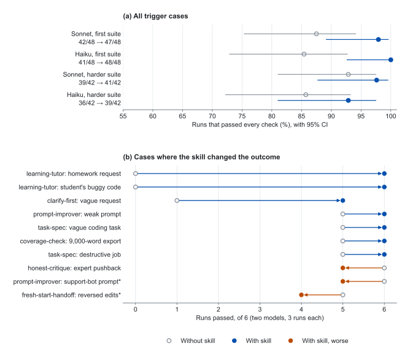

# how-to-use-ai

[](https://github.com/ji-hun-git/how-to-use-ai/actions/workflows/validate.yml) [](LICENSE) [](skills/README.md) [](evals/results/README.md)

how-to-use-ai is an evidence-based guide and a set of Agent Skills for getting reliable work out of AI assistants. The skills make an assistant ask before it guesses, account for every requirement, cite what it claims, and keep a correct answer when you push back. Every recommendation links to a paper or an official guide, and every skill is tested with and without it.

It works with Claude Code, Codex, Cursor, GitHub Copilot, Gemini and Antigravity CLI, and the ChatGPT, Claude and Gemini apps.

> [!NOTE]
> Research is current to November 9, 2026. Figures measured on older models are labeled as historical. See [Updates](#updates).

## What a skill changes

The same request, answered by the same model with and without a skill. These are unedited excerpts from the evaluation (Claude Sonnet, run 1); the [full answers](evals/results/2026-11-09-round4-hard-suite/raw.jsonl) are published.

> **Student:** I'm practicing for my data structures exam. I wrote binary search but it loops forever on some inputs. Can you help? *(their code follows; the bug is `lo = mid`)*

<table>
<tr>
<th width="50%">Without a skill</th>
<th width="50%">With <a href="skills/learning-tutor/SKILL.md"><code>learning-tutor</code></a></th>
</tr>
<tr>
<td valign="top">

The bug is in this line:

```python
elif xs[mid] < target:
    lo = mid
```

[…] **Fix:** use `lo = mid + 1`.

```python
def binary_search(xs, target):
    lo, hi = 0, len(xs) - 1
    while lo <= hi:
        mid = (lo + hi) // 2
        ...
```

*The answer goes on to give the complete corrected function.*

</td>
<td valign="top">

**Where to look:** the `elif xs[mid] < target:` branch. Compare it with the `else` branch right below it. They handle the same situation from opposite sides, but they don't look symmetric.

**Try this trace by hand:** `xs = [1, 3]`, `target = 5`. Write down `lo`, `hi` and `mid` at the start of each iteration. […]

Tell me what you find from the trace and what you think the fix is. I'll check your reasoning from there.

</td>
</tr>
</table>

Without the skill, both Claude Sonnet and Claude Haiku handed over the fix in all 6 runs. With it, they gave a hint in all 6, and still showed the full solution when a student typed "show solution".

## Results

<picture>
  <source media="(prefers-color-scheme: dark)" srcset="assets/fig-results-dark.svg">
  
</picture>

**Figure 1.** Each skill was tested on the same cases with and without the skill loaded, graded blind by Claude Opus plus code checks for counts and exact IDs. **(a)** Share of runs that passed every check on trigger cases (situations where the skill should help), with 95% Wilson intervals; 3 runs per case. **(b)** The 10 of 30 trigger cases where the skill changed the outcome, pooled over both models. Cases marked * led to skill revisions, which were re-tested in [round 5](evals/results/README.md#change-log-what-the-evaluation-caught).

- Across both suites, passing runs on trigger cases rose from 158/180 to 175/180. Control cases, where a skill should change nothing, passed 36/36 either way.
- On 20 of 30 trigger cases, current models already did the right thing without help. The skills matter most where they ask for behavior that differs from the default, such as hinting instead of answering, or asking before writing.
- The evaluation caught three weak spots in the skills themselves. Each was fixed and re-tested, and the change log says what was changed and why.

Method, all 36 cases, raw answers and limitations: [evals/results](evals/results/README.md).

## Install

**Claude Code**

```text
/plugin marketplace add ji-hun-git/how-to-use-ai
/plugin install how-to-use-ai@how-to-use-ai
```

**Codex, Cursor, GitHub Copilot, Gemini and Antigravity CLI, and other agents that read Agent Skills**

```bash
npx skills add ji-hun-git/how-to-use-ai
```

**Any coding agent, as one always-on rules file** (save it as `CLAUDE.md` for Claude Code)

```bash
curl -fsSL https://raw.githubusercontent.com/ji-hun-git/how-to-use-ai/main/drop-in/AGENTS.md -o AGENTS.md
```

**ChatGPT, Claude or Gemini apps:** paste the [custom instructions](drop-in/custom-instructions.md) into your settings.

Manual installation and per-agent folders are covered in [skills/README.md](skills/README.md) and [drop-in/README.md](drop-in/README.md).

## Skills

Skills load only when their task comes up. Each one cites the research it is built on.

| Skill | Guards against | Use it when |
|---|---|---|
| [clarify-first](skills/clarify-first/SKILL.md) | Misunderstanding | A request is vague or large. It asks up to three questions, each with a default. |
| [task-spec](skills/task-spec/SKILL.md) | Misunderstanding | You hand work to a coding agent. It writes goal, context, constraints and a checkable "done". |
| [fresh-start-handoff](skills/fresh-start-handoff/SKILL.md) | Misunderstanding | A long chat keeps going in circles. It writes one prompt to restart cleanly. |
| [coverage-check](skills/coverage-check/SKILL.md) | Omission | There are many requirements or a long input. It ends with a coverage table. |
| [grounded-answer](skills/grounded-answer/SKILL.md) | Fabrication | You answer from documents. It quotes first and cites every claim. |
| [verify-claims](skills/verify-claims/SKILL.md) | Fabrication | You fact-check before publishing. It checks claim by claim. |
| [honest-critique](skills/honest-critique/SKILL.md) | Sycophancy | You ask "is this good?" or push back. It leads with the biggest problems. |
| [fresh-eyes-review](skills/fresh-eyes-review/SKILL.md) | Sycophancy | You do a final check. It reviews against the spec, not the conversation. |
| [prompt-improver](skills/prompt-improver/SKILL.md) | All four | You write or fix a prompt. It fills the gaps and trims the rest. |
| [learning-tutor](skills/learning-tutor/SKILL.md) | Lost learning | You are learning. It gives hints first and the solution on request. |

The same rules also ship as an [18-rule AGENTS.md](drop-in/AGENTS.md), [30 copy-paste prompts](prompts/README.md) and [10 annotated templates](templates/).

## Methods and the papers behind them

Well-known methods, graded by how much they still help with late-2026 models. Many classic papers tested 2022 to 2024 models; where newer evidence exists, the verdict follows it.

| Method | Verdict for 2026 | What the evidence says | Paper |
|---|---|---|---|
| "Think step by step" (zero-shot chain of thought) | Mostly built in now | Reasoning models moved about 3 points on GPQA Diamond and took 20-80% longer | [Meincke et al., 2025 (preprint)](https://arxiv.org/abs/2506.07142) |
| Reasoning-effort setting | Use | Higher effort reduced accuracy in most runs across 9 agent benchmarks, so tune it per task | [Kapoor et al., ICLR 2026](https://arxiv.org/abs/2510.11977) |
| Self-consistency (majority vote over samples) | Situational | A 64-sample vote lifted DeepSeek-R1-Zero on AIME 2024 from 71.0% to 86.7%, but cost grows with every sample | [DeepSeek-AI, Nature 2025](https://arxiv.org/abs/2501.12948) |
| Expert personas ("You are a world-class...") | Skip (for accuracy) | No significant effect on GPQA Diamond or MMLU-Pro in 5 of 6 models | [Basil et al., 2025 (preprint)](https://arxiv.org/abs/2512.05858) |
| Search grounding | Use | GPT-4o scored 0.6% on BrowseComp without browsing; a multi-step research agent scored 51.5% | [Wei et al., 2025 (preprint)](https://arxiv.org/abs/2504.12516) |
| Allow "I don't know" | Use | Reasoning fine-tuning cut abstention by 24% across 20 frontier models | [Kirichenko et al., 2025 (preprint)](https://arxiv.org/abs/2506.09038) |
| Tool-checked self-correction | Use | ChatGPT's HotpotQA F1 rose from 42.8 to 52.9 with tools, only to 46.1 without | [Gou et al., ICLR 2024](https://arxiv.org/abs/2305.11738) |
| "Review your answer" with no new information | Skip | GPT-4 on GSM8K fell from 95.5 to 89.0 over two rounds | [Huang et al., ICLR 2024](https://arxiv.org/abs/2310.01798) |
| Hide authorship, third-person framing | Use | A third-person perspective cut sycophancy by up to 63.8% | [Hong et al., Findings of EMNLP 2025](https://arxiv.org/abs/2505.23840) |
| Fresh chat with one summary | Use | Instructions spread over turns cut performance by 39% on average | [Laban et al., ICLR 2026](https://arxiv.org/abs/2505.06120) |
| Multi-agent debate | Skip | Majority voting explains most of the gain across seven benchmarks | [Choi et al., NeurIPS 2025](https://arxiv.org/abs/2508.17536) |
| Lean context | Use | 11 of 13 long-context models fell below half their short-context score at 32K tokens | [Modarressi et al., ICML 2025](https://arxiv.org/abs/2502.05167) |

All 73 methods, with the evidence, the 192 sources and copyable prompt patterns, are in [docs/14](docs/14-methods-and-papers.md).

## The four failure modes

Most bad answers fail in one of four ways. Each has a documented cause and a fix.

| Failure mode | Why it happens | What fixes it | Guide |
|---|---|---|---|
| **Misunderstanding** | Requests leave gaps, and models assume instead of asking, then lock in early assumptions | State the goal, audience and done criteria up front; ask up to three questions; restart long chats | [docs/04](docs/04-failure-modes.md#1-misunderstanding) |
| **Omission** | Accuracy drops as inputs get longer, and compliance falls as rules pile up | Number the requirements, put documents first and the question last, end with a coverage table | [docs/04](docs/04-failure-modes.md#2-omission) |
| **Fabrication** | Training and evaluation reward a confident guess over "I don't know" | Allow abstaining, quote before answering, cite or retract, open every source | [docs/04](docs/04-failure-modes.md#3-fabrication-hallucination) |
| **Sycophancy** | Preference training rewards agreement, and people trust flattery more | Set criteria first, hide who wrote the work, change answers only on new evidence | [docs/04](docs/04-failure-modes.md#4-bonus-sycophancy) |

This four-part taxonomy is the repo's own way of teaching the material. The causes and fixes under each are linked to research in [docs/04](docs/04-failure-modes.md).

## Common prompts, and what to write instead

| You write | What tends to happen | Write this instead | Evidence |
|---|---|---|---|
| "Give me 5 studies on X with links." | Plausible but invented references: models released in 2026 fabricated references in 35% of responses in one study | "Search, and list only papers you actually opened. Fewer than 5 is fine." | [Topaz et al., 2026 (preprint)](https://arxiv.org/abs/2609.14988) |
| "Are you sure?" | Models change their answer 46% of the time (2023), current models still give way under sustained pushback, and self-review with nothing new to check against tends to make answers worse | "Check step 3 against the table (or a test, or a calculation) and tell me what changes." | [FlipFlop](https://arxiv.org/abs/2311.08596), [SPINE, 2026](https://arxiv.org/abs/2609.09090), [Huang et al., ICLR 2024](https://arxiv.org/abs/2310.01798) |
| Requirements added one message at a time | Performance drops 39% on average | Put everything in one prompt, then start a fresh chat | [Laban et al., ICLR 2026](https://arxiv.org/abs/2505.06120) |
| "You are a world-class expert…" | No reliable gain in accuracy | State the audience, the purpose and what "done" means | [Wharton, Report 4](https://gail.wharton.upenn.edu/research-and-insights/playing-pretend-expert-personas/) |
| A prompt with 20 rules | Compliance with all of them collapses beyond about 5 or 6 | Keep about five rules, number them, and ask for a coverage table | [Vasileva, 2026 (preprint)](https://arxiv.org/abs/2608.12426) |

Twelve common prompts, each diagnosed and fixed, are in the [prompt clinic](examples/08-prompt-clinic.md).

## Guides

| | Guide | Question it answers |
|---|---|---|
| 01 | [Mindset](docs/01-mindset.md) | How should you think about AI, and when should you not use it? |
| 02 | [The six elements of a prompt](docs/02-prompt-anatomy.md) | How do you write role, context, instruction, format, constraints and examples? |
| 03 | [Teaching with examples (few-shot)](docs/03-examples-few-shot.md) | How many examples, and how do you choose them? |
| 04 | [Failure modes](docs/04-failure-modes.md) | Why does AI get things wrong, and how do you prevent and catch it? |
| 05 | [Models and reasoning](docs/05-models-and-reasoning.md) | Which models and tools, and how do reasoning models differ? |
| 06 | [Workflows](docs/06-workflows.md) | How do you go from one prompt to a repeatable way of working? |
| 07 | [AI coding](docs/07-ai-coding.md) | How do you move from vibe coding to agentic engineering? |
| 08 | [Verification and evaluation](docs/08-verification-and-evals.md) | How do you check an answer and evaluate a prompt? |
| 09 | [Security and privacy](docs/09-security-privacy.md) | What should you never paste in, and what is prompt injection? |
| 10 | [Myths vs. evidence](docs/10-myths-vs-evidence.md) | Do tips, personas and "think step by step" actually work? |
| 11 | [Where instructions should live](docs/11-skills-and-agent-rules.md) | Prompt, rules file, skill or hook? |
| 12 | [Writing decision rules](docs/12-writing-decision-rules.md) | How do you put real judgment into a skill and prove it works? |
| 13 | [Verifying agent runs](docs/13-verifying-agent-runs.md) | The run finished without errors. Is the result right? |
| 14 | [Methods and the papers behind them](docs/14-methods-and-papers.md) | Which well-known methods still work in 2026, and what is the evidence? |

<details>
<summary><strong>Worked examples</strong></summary>

| | Example | What you learn |
|---|---|---|
| 1 | [Work email, one element at a time](examples/01-email-step-by-step.md) | How each of the six elements changes the result |
| 2 | [Summarizing a long document](examples/02-document-summary.md) | Preventing omission and fabrication together |
| 3 | [Research with sources](examples/03-research-with-sources.md) | Filtering out fake sources |
| 4 | [Data analysis](examples/04-data-analysis.md) | Calculations in code, assumptions in the open |
| 5 | [Fixing a bug with a coding agent](examples/05-coding-agent.md) | Explore, plan, test, implement, verify |
| 6 | [Learning with AI](examples/06-learning-with-ai.md) | Gaining understanding, not just answers |
| 7 | [Designing your own agent](examples/07-build-your-own-agent.md) | From task analysis to an evaluation set |
| 8 | [Prompt clinic](examples/08-prompt-clinic.md) | Twelve common prompts, diagnosed and fixed |

</details>

<details>
<summary><strong>Where to start</strong></summary>

| Time | For | Read |
|---|---|---|
| 5 minutes | Everyone | Install the [skills](skills/README.md) or paste the [custom instructions](drop-in/custom-instructions.md), then skim the [cheatsheet](CHEATSHEET.md) |
| 30 minutes | Beginners | [02](docs/02-prompt-anatomy.md), [example 1](examples/01-email-step-by-step.md), the [prompt clinic](examples/08-prompt-clinic.md) and the [universal template](templates/universal-prompt.md) |
| 2 hours | Using AI seriously at work | Add [01](docs/01-mindset.md), [04](docs/04-failure-modes.md), [08](docs/08-verification-and-evals.md), [10](docs/10-myths-vs-evidence.md), the short version of [14](docs/14-methods-and-papers.md#the-short-version) and examples 2 to 4 |
| 1 day | Developers and agent builders | Add [05](docs/05-models-and-reasoning.md), [06](docs/06-workflows.md), [07](docs/07-ai-coding.md), [09](docs/09-security-privacy.md), [11](docs/11-skills-and-agent-rules.md), [12](docs/12-writing-decision-rules.md), [13](docs/13-verifying-agent-runs.md), [14](docs/14-methods-and-papers.md), examples 5 and 7, and the [evals](evals/README.md) |

</details>

## How the evidence is handled

- **Primary sources first.** Official guides from Anthropic, OpenAI, Google and Microsoft were checked directly on November 9, 2026. Papers are cited by title, venue and link, and preprints are marked as preprints. The [evidence report](research/evidence-report.md) lists 460+ sources with what each one supports.
- **Old numbers are labeled.** A statistic measured on 2023 models is shown as historical, next to the newest measurement where one exists.
- **Myths are tested, not repeated.** Popular tips such as offering a tip, threatening the model or assigning an expert persona are checked against controlled studies in [docs/10](docs/10-myths-vs-evidence.md).
- **Skills are measured.** Each skill is evaluated with and without it, and the cases, raw answers and grades are published, including where the skill made no difference or made things worse.

[COMPARISON.md](COMPARISON.md) sets this repo next to the most popular related repositories, including when another one is the better choice.

## Repository contents

| Folder | Contents |
|---|---|
| [`skills/`](skills/README.md) | 10 Agent Skills, installable as a Claude Code plugin, with `npx skills`, or by copying |
| [`drop-in/`](drop-in/README.md) | The same rules as one file for AGENTS.md, CLAUDE.md, Cursor and chat apps |
| [`docs/`](docs/) | 14 guides |
| [`prompts/`](prompts/README.md) | 30 copy-paste prompts by task |
| [`templates/`](templates/) | 10 annotated templates |
| [`examples/`](examples/) | 8 worked examples, including the prompt clinic |
| [`evals/`](evals/README.md) | A promptfoo comparison and the with-vs-without skill harness, with [results](evals/results/README.md) |
| [`research/`](research/) | The [evidence report](research/evidence-report.md) and the [2026 update report](research/2026-update-report.md) |
| [`resources/`](resources/awesome.md) | Curated official guides, courses and repositories |

A one-page summary is in [CHEATSHEET.md](CHEATSHEET.md), and a machine-readable index for AI tools is in [llms.txt](llms.txt).

## Updates

AI tools and official guidance change every few months. This repo states its research date, records every change in the [CHANGELOG](CHANGELOG.md), and fixes or flags advice that has gone stale. Fast-changing details such as model names are kept out of the core advice where possible.

## Contributing

Reports of wrong or outdated claims, broken links and skills that misfire are welcome. [Open an issue](https://github.com/ji-hun-git/how-to-use-ai/issues/new/choose) using one of the forms; [CONTRIBUTING.md](CONTRIBUTING.md) explains what makes a report easy to act on. Security problems go through [private reporting](SECURITY.md).

## License

[MIT](LICENSE). Rights to external material quoted or summarized remain with the original authors.
