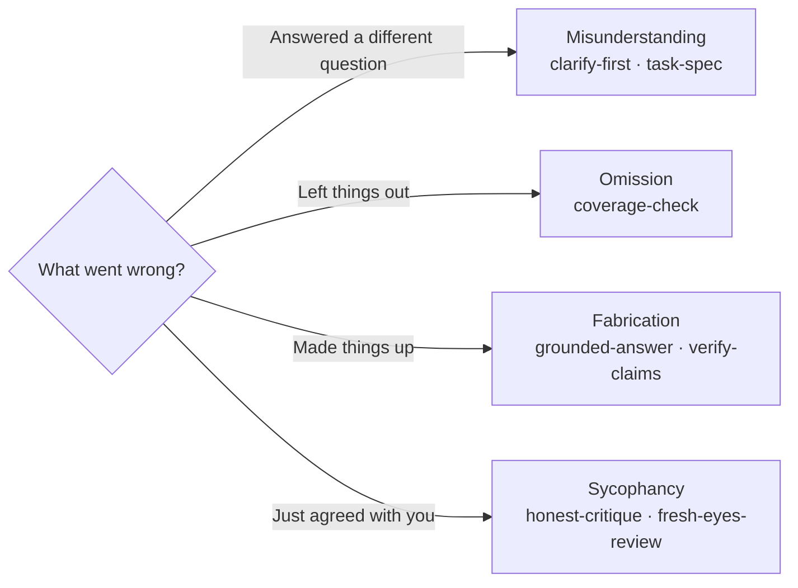
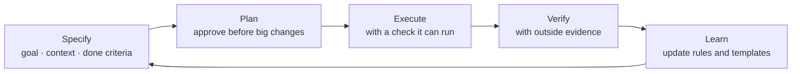

# how-to-use-ai

**Stop AI from misunderstanding you, skipping things, making things up and just agreeing with you, with evidence instead of prompt hacks.**

Read the guide, or install it into your AI agent in one line.

[](https://github.com/ji-hun-git/how-to-use-ai/actions/workflows/validate.yml)   [](evals/results/README.md)  

[Install](#install-in-one-line) · [Before/after](#before--after) · [The four failure modes](#the-four-failure-modes-and-what-fixes-them) · [Guides](#guides) · [Prompt library](prompts/README.md) · [Cheatsheet](CHEATSHEET.md) · [How it compares](COMPARISON.md)

---

## Install in one line

| You use | Run or do this |
|---|---|
| **Claude Code** | `/plugin install how-to-use-ai --marketplace ji-hun-git/how-to-use-ai` |
| **Codex, Copilot, Gemini CLI, Cursor and other agents** | `npx skills add ji-hun-git/how-to-use-ai` |
| **Any coding agent, as an always-on rules file** | `curl -fsSL https://raw.githubusercontent.com/ji-hun-git/how-to-use-ai/main/drop-in/AGENTS.md -o AGENTS.md` (save as `CLAUDE.md` for Claude Code) |
| **ChatGPT, Claude, Gemini (chat apps)** | Paste the [custom instructions](drop-in/custom-instructions.md) into your settings |

What you get: [10 skills](skills/README.md) that load automatically when a task needs them, or one [18-rule file](drop-in/AGENTS.md) that's always on. Every rule links to the research behind it. Other install options: [skills/README.md](skills/README.md) · [drop-in/README.md](drop-in/README.md).

**Measured, not assumed.** In a blind with-vs-without test, loading the skills raised Claude Haiku from 41/48 to **48/48** passing runs on trigger cases and Claude Sonnet from 42/48 to **47/48**, with no regressions on control cases. The biggest change was tutoring: 0/6 → 6/6. On most cases, current models already did fine without the skills, and the test caught (and we fixed) a flaw in one skill. → [Eval results](evals/results/README.md)

---

## Before / after

| You write | What tends to happen | Write this instead | Evidence |
|---|---|---|---|
| "Give me 5 studies on X with links." | Plausible but invented references. 2026-released models fabricated references in **35%** of responses in one study | "Use search. Only list papers you actually opened; fewer than 5 is fine." | [Topaz et al., 2026 (preprint)](https://arxiv.org/abs/2609.14988) |
| "Are you sure?" | Correct answers get flipped **46%** of the time (2023 study); current models still cave under sustained pushback | "Re-solve from scratch and show where the first answer was wrong, if it was." | [FlipFlop](https://arxiv.org/abs/2311.08596) · [SPINE, 2026](https://arxiv.org/abs/2609.09090) |
| Requirements added one message at a time | Performance drops **39%** on average | "Consolidate everything into one prompt," then start a fresh chat | [Laban et al., ICLR 2026](https://arxiv.org/abs/2505.06120) |
| "You are a world-class expert…" | No reliable accuracy gain | State the audience, purpose and done criteria | [Wharton Report 4](https://gail.wharton.upenn.edu/research-and-insights/playing-pretend-expert-personas/) |
| A 20-rule prompt | Compliance with all rules collapses beyond about **5–6** at once | Keep ~5 rules, number them, ask for a coverage table | [Vasileva, 2026 (preprint)](https://arxiv.org/abs/2608.12426) |

12 more, with fixes: [the prompt clinic](examples/08-prompt-clinic.md).

---

## The four failure modes and what fixes them

Almost every bad AI answer is one of four things. Each has a documented cause and a fix, and each fix is available as a prompt, a skill and a rule.



| Failure mode | Why it happens | Fix | Skill | Guide |
|---|---|---|---|---|
| **Misunderstanding** | Requests leave gaps; models assume instead of asking, and lock in early assumptions | Goal, audience and done criteria up front; up to 3 questions with defaults; restart long chats | [clarify-first](skills/clarify-first/SKILL.md), [task-spec](skills/task-spec/SKILL.md), [fresh-start-handoff](skills/fresh-start-handoff/SKILL.md) | [docs/04 §1](docs/04-failure-modes.md#1-misunderstanding) |
| **Omission** | The middle of long inputs is used least; compliance falls as rules pile up | Number requirements, documents first and question last, work in sections, coverage table | [coverage-check](skills/coverage-check/SKILL.md) | [docs/04 §2](docs/04-failure-modes.md#2-omission) |
| **Fabrication** (hallucination) | Training and evaluation reward guessing over "I don't know" | Permission to abstain, quote first, cite or retract, open every source | [grounded-answer](skills/grounded-answer/SKILL.md), [verify-claims](skills/verify-claims/SKILL.md) | [docs/04 §3](docs/04-failure-modes.md#3-fabrication-hallucination) |
| **Sycophancy** | Preference training rewards agreement; people trust flattery more | Hide authorship, criteria first, change answers only on new evidence, fresh-eyes review | [honest-critique](skills/honest-critique/SKILL.md), [fresh-eyes-review](skills/fresh-eyes-review/SKILL.md) | [docs/04 §4](docs/04-failure-modes.md#4-bonus-sycophancy) |

"Misunderstanding · Omission · Fabrication (+ Sycophancy)" is this repo's own teaching taxonomy; the causes and fixes under each are linked to research.

---

## The 30-second version

> **Good AI use isn't a clever sentence. It's good instructions plus good verification.**

**1. Instruct with six elements.** Spend your effort on the three starred ones.

| Role | Context ★ | Instruction ★ | Format ★ | Constraints | Examples |
|---|---|---|---|---|---|
| Perspective and tone (doesn't improve accuracy) | Why, for whom, what situation, source material | What to do, and what "done" means | Structure and length | Only the rules that matter, with reasons | 2–5 varied samples |

**2. Work in a loop.**



**3. Verify in proportion to the stakes.** Skim drafts; check numbers and citations in work documents; open every source and recompute every number for anything legal, medical, financial or public. → [docs/08](docs/08-verification-and-evals.md)

---

## What's inside

| Folder | What it is | Start here |
|---|---|---|
| [`skills/`](skills/README.md) | 10 installable Agent Skills (Claude Code plugin, `npx skills`, manual) | [skills/README.md](skills/README.md) |
| [`drop-in/`](drop-in/README.md) | One rules file for AGENTS.md / CLAUDE.md / Cursor / chat apps | [drop-in/AGENTS.md](drop-in/AGENTS.md) |
| [`prompts/`](prompts/README.md) | 30 copy-paste prompts by task, tagged by the failure modes they prevent | [prompts/README.md](prompts/README.md) |
| [`templates/`](templates/) | 10 annotated templates (universal prompt, clarify, coverage, grounding, critique, meta-prompt, coding task, AGENTS.md, skill with decision rules, agent test plan) | [universal prompt](templates/universal-prompt.md) |
| [`examples/`](examples/) | 8 before/after walkthroughs, including the 12-case prompt clinic | [prompt clinic](examples/08-prompt-clinic.md) |
| [`docs/`](docs/) | 13 guides | [the four failure modes](docs/04-failure-modes.md) |
| [`evals/`](evals/README.md) | A runnable promptfoo test, plus a with-vs-without harness for all 10 skills | [evals/README.md](evals/README.md) |
| [`research/`](research/) | Two sourced research reports with verification status for each claim | [evidence report](research/evidence-report.md) |

---

## Guides

| # | Guide | Key question |
|---|---|---|
| 01 | [Mindset](docs/01-mindset.md) | How should you think of AI? When should you not use it? |
| 02 | [The six elements of a prompt](docs/02-prompt-anatomy.md) | How do you write Role · Context · Instruction · Format · Constraints · Examples? |
| 03 | [Instructing with examples](docs/03-examples-few-shot.md) | How many examples, and how do you choose them? |
| 04 | [Misunderstanding · Omission · Fabrication](docs/04-failure-modes.md) | Why does AI get things wrong, and how do you prevent and catch it? |
| 05 | [Models and reasoning](docs/05-models-and-reasoning.md) | Which models and tools? How do reasoning models differ? |
| 06 | [Workflows](docs/06-workflows.md) | Context engineering, five patterns, playbooks by task, memory |
| 07 | [AI coding](docs/07-ai-coding.md) | From vibe coding to agentic engineering |
| 08 | [Verification and evaluation](docs/08-verification-and-evals.md) | How do you verify an answer and evaluate a prompt? |
| 09 | [Security and privacy](docs/09-security-privacy.md) | What should you never put in? What about prompt injection? |
| 10 | [Myths vs. evidence](docs/10-myths-vs-evidence.md) | Do "I'll tip you," "act like an expert" and "think step by step" work? |
| 11 | [Where instructions should live](docs/11-skills-and-agent-rules.md) | Prompt, rules file, skill or hook? |
| 12 | [Writing decision rules](docs/12-writing-decision-rules.md) | How do you put real judgment into a skill, and prove it works? |
| 13 | [Verifying agent runs](docs/13-verifying-agent-runs.md) | The run finished without errors. Is the result actually right? |

### Examples

| # | Example | What you learn |
|---|---|---|
| 1 | [Work email, one element at a time](examples/01-email-step-by-step.md) | How the six elements change the result |
| 2 | [Summarizing a long document](examples/02-document-summary.md) | Preventing omission and fabrication together |
| 3 | [Research with sources](examples/03-research-with-sources.md) | Filtering out fake sources |
| 4 | [Data analysis](examples/04-data-analysis.md) | Calculations in code, assumptions in the open |
| 5 | [Fixing a bug with a coding agent](examples/05-coding-agent.md) | Explore → plan → test → implement → verify |
| 6 | [Learning with AI](examples/06-learning-with-ai.md) | Gaining understanding, not just answers |
| 7 | [Designing your own agent](examples/07-build-your-own-agent.md) | Task analysis → instructions → evaluation set → security |
| 8 | [Prompt clinic](examples/08-prompt-clinic.md) | 12 common prompts diagnosed and fixed |

---

## Learning paths

| Time | For | Order |
|---|---|---|
| **5 minutes** | Everyone | Install the [skills](skills/README.md) or paste the [custom instructions](drop-in/custom-instructions.md) → skim the [cheatsheet](CHEATSHEET.md) |
| **30 minutes** | Beginners | [02. Six elements](docs/02-prompt-anatomy.md) → [Example 1](examples/01-email-step-by-step.md) → [Prompt clinic](examples/08-prompt-clinic.md) → [Universal template](templates/universal-prompt.md) |
| **2 hours** | Using AI seriously at work | + [01. Mindset](docs/01-mindset.md) → [04. Failure modes](docs/04-failure-modes.md) → [08. Verification](docs/08-verification-and-evals.md) → [10. Myths](docs/10-myths-vs-evidence.md) → Examples 2–4 |
| **1 day** | Developers and agent builders | + [05](docs/05-models-and-reasoning.md) → [06](docs/06-workflows.md) → [07](docs/07-ai-coding.md) → [09](docs/09-security-privacy.md) → [11](docs/11-skills-and-agent-rules.md) → [12](docs/12-writing-decision-rules.md) → [13](docs/13-verifying-agent-runs.md) → Examples 5 and 7 → [evals](evals/README.md) |

---

## Why this repo

1. **Evidence first.** 460+ cited sources. Lab guides were checked directly on 2026-11-09, papers by bibliographic details and abstracts, and older statistics are labeled as historical. → [What is verified and what is not](research/evidence-report.md#8-what-is-verified-and-what-is-not)
2. **Read it or install it.** The same evidence ships as guides, as [skills](skills/README.md), as a [rules file](drop-in/AGENTS.md) and as a [prompt library](prompts/README.md).
3. **Tested.** The skills are measured with and without, blind-graded, with every answer published, including where they made no difference. → [results](evals/results/README.md)
4. **Built around failure modes, not tricks**, including sycophancy, which coding-focused repos rarely cover.
5. **Myth-busting.** Shows which popular tips fail in controlled studies. → [docs/10](docs/10-myths-vs-evidence.md)
6. **For everyone.** Writing, research, analysis and learning, not only coding.

### Myths vs. evidence (highlights)

| Popular tip | Verdict | Evidence |
|---|---|---|
| "I'll tip you" / threats | No reliable effect | Wharton Report 3 (2025) |
| Being polite (or bossy) | No overall difference | Wharton Report 1 (2025) |
| "You are the world's best expert" | No accuracy gain, sometimes worse | Wharton Report 4 (2025), Zheng et al. (2024) |
| "Think step by step" on reasoning models | Almost no effect, only more time | Wharton Report 2 (2025), OpenAI, Microsoft |
| ALL CAPS, "NEVER!!!", "IMPORTANT" | Newest models over-apply it | Anthropic, OpenAI |
| Specifying output format is trivial | **Wrong: format instructions improve accuracy** | Wharton Report 1 (2025) |
| "Are you really sure?" as a check | Flips correct answers | FlipFlop (2023), SPINE (2026) |

How this repo compares with the most popular ones, and when another is the better choice: [COMPARISON.md](COMPARISON.md).

---

## 🆕 2026 update (2026-11-09)

| What changed | Summary |
|---|---|
| **Hallucination is down, not gone** | The newest models say "I don't know" more often, but 2026-released models still fabricated references in 35% of responses in one study, and court filings with AI-fabricated case law reached 2,266 → [04](docs/04-failure-modes.md#-2026-update-how-current-models-fare) |
| **Sycophancy grows in long conversations** | Under persistent pushback, even the newest models caved in 20–97% of cases within 25 turns; people trust sycophantic answers more (*Science* 2026) → make important judgments in a **fresh chat** |
| **1M tokens: retrieval solved, synthesis not** | Finding one fact in long material is near-perfect; reasoning across many pieces still degrades → include only what's needed |
| **AI coding: from "reading every line" to "verifying with evidence"** | `/goal`, Stop hooks and independent review agents are now standard → [07](docs/07-ai-coding.md#-what-changed-in-2026-from-reading-every-line-to-verifying-with-evidence) |
| **Local laws (example: South Korea)** | The AI Basic Act took effect 2026-01-22; labeling duties fall on AI providers → [09](docs/09-security-privacy.md#5-local-laws-and-guidelines-example-south-korea-2026) |

Full history: [CHANGELOG](CHANGELOG.md) · Evidence: [2026 update report](research/2026-update-report.md)

---

## Key sources

| Category | Representative sources |
|---|---|
| Official lab guides | [Anthropic](https://platform.claude.com/docs/en/build-with-claude/prompt-engineering/claude-prompting-best-practices) · [OpenAI](https://developers.openai.com/api/docs/guides/prompt-engineering) · [Google](https://aistudio.google.com/docs/prompting-strategies) · [Microsoft](https://learn.microsoft.com/en-us/azure/foundry/openai/concepts/prompt-engineering) · [Claude Code](https://code.claude.com/docs/en/best-practices) · [Codex](https://learn.chatgpt.com/guides/best-practices) |
| Andrej Karpathy | [How I use LLMs](https://www.youtube.com/watch?v=EWvNQjAaOHw) · [Deep Dive into LLMs](https://www.youtube.com/watch?v=7xTGNNLPyMI) · [Sequoia Ascent 2026](https://karpathy.bearblog.dev/sequoia-ascent-2026/) · [nanochat](https://github.com/karpathy/nanochat) · [llm-council](https://github.com/karpathy/llm-council) |
| Universities and research | [MIT Sloan](https://mitsloanedtech.mit.edu/ai/basics/effective-prompts/) · [Wharton Prompting Science Reports](https://arxiv.org/abs/2503.04818) · [Harvard/BCG Jagged Frontier](https://www.oneusefulthing.org/p/centaurs-and-cyborgs-on-the-jagged) · [Stanford legal AI hallucinations](https://hai.stanford.edu/news/ai-trial-legal-models-hallucinate-1-out-6-or-more-benchmarking-queries) · [The Prompt Report](https://arxiv.org/abs/2406.06608) |
| Research on failures | [Lost in the Middle](https://arxiv.org/abs/2307.03172) · [Why LMs Hallucinate](https://arxiv.org/abs/2509.04664) · [LLMs Get Lost in Multi-Turn](https://arxiv.org/abs/2505.06120) · [Sycophancy](https://arxiv.org/abs/2310.13548) · [Chain-of-Verification](https://arxiv.org/abs/2309.11495) |
| Standards | [Agent Skills](https://agentskills.io/specification) · [AGENTS.md](https://agents.md/) |

Full list: [resources/awesome.md](resources/awesome.md) · All sources: [evidence report](research/evidence-report.md#references) and [2026 update report](research/2026-update-report.md)

---

## Repository structure

```
how-to-use-ai/
├── README.md                 ← you are here
├── CHEATSHEET.md             ← one-page summary
├── COMPARISON.md             ← how this repo compares with popular ones
├── CHANGELOG.md              ← change history
├── llms.txt                  ← machine-readable index for AI tools
├── skills/                   ← 10 installable Agent Skills
├── drop-in/                  ← rules file: AGENTS.md / CLAUDE.md / Cursor / chat apps
├── prompts/                  ← 30-prompt library
├── templates/                ← 10 annotated templates
├── examples/                 ← 8 before/after examples
├── docs/                     ← 13 guides
├── evals/                    ← promptfoo test + skill eval harness
├── research/                 ← evidence report + 2026 update report
├── scripts/validate.py       ← checks skills, manifests and links (run in CI)
└── .claude-plugin/           ← Claude Code plugin and marketplace manifests
```

---

## Update policy

AI tools and official guides change every few months. This repo states its **research date (currently 2026-11-09)**, records changes in the [CHANGELOG](CHANGELOG.md), and flags or fixes advice that has gone stale. Fast-changing details such as model names are kept out of the core advice wherever possible.

Found an error or a broken link? Open an issue: https://github.com/ji-hun-git/how-to-use-ai/issues

## License

[MIT](LICENSE). Rights to external material quoted or summarized in each document remain with the original authors.
