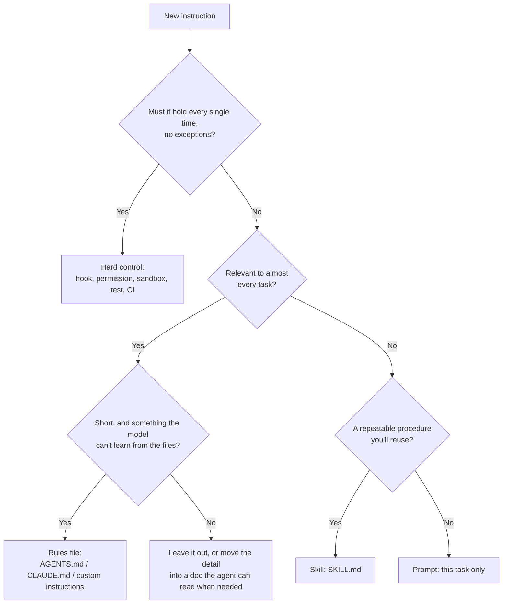

# 11. Where instructions should live: prompts, rules files, skills and hooks

> In 2026 you can give an AI instructions in four places: the prompt, an always-loaded rules file (AGENTS.md / CLAUDE.md / custom instructions), an on-demand skill, or a hard control (hooks, permissions, tests, CI). Putting each instruction in the right place matters as much as how you word it.

---

## 1. The four places

| Place | Loaded | Enforced? | Best for | Example |
|---|---|---|---|---|
| **Prompt** | This task only | No (the model decides) | Task-specific goal, context, done criteria | "Summarize this contract for the sales team; flag renewal terms." |
| **Rules file** (AGENTS.md, CLAUDE.md, custom instructions) | Every session | No | Short, always-relevant facts and habits the model can't infer | Build/test commands; "say when you couldn't verify something" |
| **Skill** (SKILL.md) | Only when the task matches its description | No | Repeatable procedures used now and then | A fact-checking procedure; a release checklist |
| **Hard control** (hooks, deny rules, sandbox, tests, CI, branch protection) | Always | **Yes** | Rules that must never be broken | Block reading `.env`; block pushes to `main`; tests must pass |

The split between "the model decides" and "the harness enforces" comes from Claude Code's own documentation: prompts, CLAUDE.md and skills are followed most of the time, while hooks, deny rules, tests and CI apply every time. If you keep adding emphasis to a rule because it's being ignored, that rule belongs in a hard control.

---

## 2. Rules files: keep them short

- **Only what the model can't find out itself:** commands, conventions that aren't visible in the code, decisions and their reasons, recurring mistakes.
- **Short:** Claude Code recommends staying under about 200 lines, and Anthropic's 2026 memory guidance notes that longer instruction files are followed less reliably.
- **Add a line when a mistake repeats** (OpenAI's Codex guide gives the same advice).
- **No ALL-CAPS emphasis;** give the reason instead.

A ready-made, evidence-based rules file: [drop-in/AGENTS.md](../drop-in/AGENTS.md). A project template: [templates/AGENTS.template.md](../templates/AGENTS.template.md).

---

## 3. Skills: small, single-purpose, well described

A skill is a folder with a `SKILL.md`: YAML frontmatter (`name`, `description`) and Markdown instructions, plus optional `scripts/`, `references/` and `assets/`. Agents keep only the name and description in context and load the body when a task matches, so many skills cost little.

**Writing a description that triggers correctly**
- Say what it does **and when to use it**, with the words users actually type ("fact-check", "review", "summarize this PDF").
- Write it in third person, and keep it under 1,024 characters (the spec's limit).
- Name the situations where it should *not* run if confusion is likely.

**Keep the body focused:** one job, numbered steps, an output format, and under 500 lines (the spec's guidance). Put long reference material in separate files the skill links to.

**Test it:** write a handful of realistic requests that should trigger it and some that shouldn't, and check behavior with and without the skill (Anthropic recommends at least three evals and testing on more than one model size).

**Security:** a skill can include scripts and instructions that run with your agent's permissions. Install skills only from sources you trust, and read them first.

Ten ready-made skills built from this guide: [skills/](../skills/README.md). How to write rules that make a skill change its results, and test them: [docs/12](12-writing-decision-rules.md).

---

## 4. Hard controls for the rules that matter most

| Rule | Hard control |
|---|---|
| Never read secrets | Deny rule on `.env`, `secrets/**`; sandbox network access |
| Never push to main | Branch protection |
| Never finish with failing tests | CI required check; a Stop hook that blocks finishing until tests pass |
| Never send or delete without approval | Approval setting for those tools |
| Untrusted content + private data + outbound actions | Remove one of the three ([docs/09](09-security-privacy.md#3-the-lethal-trifecta-and-the-rule-of-two)) |

---

## 5. Checklist

- [ ] Every "never/always" rule that truly matters is enforced by a hard control, not only written down.
- [ ] The rules file is short and contains only what the model can't infer.
- [ ] Repeated procedures are skills with descriptions that say when to use them.
- [ ] Each task prompt still states its own goal, context and done criteria.

---

### Sources
- Claude Code best practices (deterministic vs non-deterministic controls, CLAUDE.md length, Stop hooks) — https://code.claude.com/docs/en/best-practices
- Claude Code skills — https://code.claude.com/docs/en/skills
- Agent Skills specification — https://agentskills.io/specification
- Anthropic, Agent Skills best practices — https://platform.claude.com/docs/en/agents-and-tools/agent-skills/best-practices
- Anthropic, Equipping agents for the real world with Agent Skills — https://www.anthropic.com/engineering/equipping-agents-for-the-real-world-with-agent-skills
- Anthropic, The components of agent memory (2026-11) — https://www.anthropic.com/engineering/components-of-agent-memory
- OpenAI Codex best practices — https://learn.chatgpt.com/guides/best-practices
- AGENTS.md open standard — https://agents.md/
