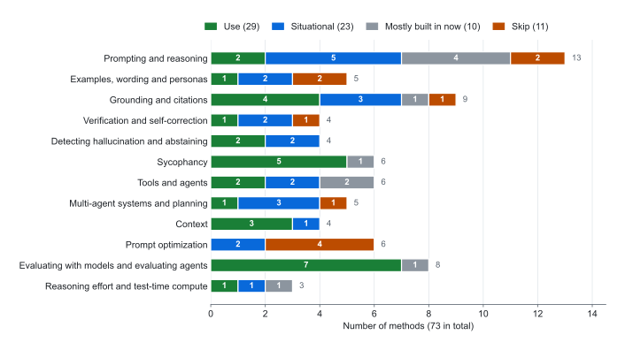

# 14. Methods and the papers behind them

> A practitioner's catalog of well-known methods for prompting, grounding, checking and running AI, each graded by how much it still helps with late-2026 models and agents.
> Every verdict rests on the evidence cited next to it, as of 2026-11-09. Many canonical papers tested 2022-2024 models. Where newer evidence exists, the verdict follows the newer evidence.

---

## How to read the verdicts

| Verdict | Meaning |
|---|---|
| **Use** | Still helps current models in most settings where it applies. |
| **Situational** | Helps only for certain models, tasks or budgets. The entry says when. |
| **Mostly built in now** | Reasoning models, agent products or vendor training already do this. Doing it by hand adds little and can cost time. |
| **Skip** | No reliable benefit with current models, or the cost outweighs the benefit. |

- **Preprint** means no peer-reviewed venue was confirmed. Vendor engineering posts report internal evaluations that are not peer reviewed; they are labeled as vendor results.
- Numbers describe the models each study tested, and old numbers are shown with their model.
- Where no 2025-2026 study was found, the entry says so. Those verdicts rest on the original paper plus indirect evidence and are the most likely to change.

<picture>
  <source media="(prefers-color-scheme: dark)" srcset="../assets/fig-verdicts-dark.svg">
  
</picture>

**Figure 1.** Verdicts for the 73 methods in this guide, by group. The chart is drawn from the tables below by `scripts/make_assets.py`.

The four failure modes are explained in [04. Failure modes](04-failure-modes.md), and popular tricks in [10. Myths vs. evidence](10-myths-vs-evidence.md). For a wider catalog without verdicts, the Prompt Report lists 58 text prompting techniques ([Schulhoff et al., 2024, preprint](https://arxiv.org/abs/2406.06608)).

---

## The short version

1. **Set reasoning effort instead of writing reasoning prompts.** "Think step by step" moved o3-mini and o4-mini about 3 points on GPQA Diamond and added 20-80% to response time ([Meincke et al., 2025, preprint](https://arxiv.org/abs/2506.07142)); higher effort reduced accuracy in most runs across 9 agent benchmarks ([Kapoor et al., ICLR 2026](https://arxiv.org/abs/2510.11977)).
2. **Self-correction needs feedback from outside the model.** Tool-based critique raised ChatGPT's HotpotQA F1 from 42.8 to 52.9, but only to 46.1 without the tools ([Gou et al., ICLR 2024](https://arxiv.org/abs/2305.11738)); with no outside feedback, GPT-4 on GSM8K fell from 95.5 to 89.0 ([Huang et al., ICLR 2024](https://arxiv.org/abs/2310.01798)).
3. **Ground answers in sources, then check the sources.** GPT-4o with web search still left about 30% of medical statements unsupported by its own citations ([Wu et al., Nature Communications 2025](https://pmc.ncbi.nlm.nih.gov/articles/PMC12003634/)).
4. **Give the model permission to abstain.** Reasoning fine-tuning cut abstention by 24% on average across 20 frontier models ([Kirichenko et al., 2025, preprint](https://arxiv.org/abs/2506.09038)).
5. **Keep context lean.** When question and answer shared no words, 11 of 13 long-context models fell below half their short-context score at 32K tokens ([Modarressi et al., ICML 2025](https://arxiv.org/abs/2502.05167)).
6. **Remove sycophancy triggers instead of asking for honesty.** Rewriting a statement as a question beat a "don't be sycophantic" instruction on GPT-4o, GPT-5 and Claude Sonnet 4.5 ([Dubois et al., 2026, preprint](https://arxiv.org/abs/2602.23971)).
7. **Vote before you debate.** Majority voting accounts for most of the gains credited to multi-agent debate across seven benchmarks ([Choi et al., NeurIPS 2025](https://arxiv.org/abs/2508.17536)).
8. **In agents, tools and outcome-based evals beat prompt wording.** On-demand tool search raised an MCP eval from 49% to 74% for Claude Opus 4 ([Anthropic, 2025, vendor result](https://www.anthropic.com/engineering/advanced-tool-use)), and benchmark flaws can misestimate agent performance by up to 100% relative ([Zhu et al., 2025, preprint](https://arxiv.org/abs/2507.02825)).

---

## 1. Prompting and reasoning

| Method | What it is | Verdict for 2026 | Evidence |
|---|---|---|---|
| Zero-shot chain of thought | Add "Let's think step by step", no examples | Mostly built in now | Raised text-davinci-002 on GSM8K from 10.4% to 40.7% ([Kojima et al., NeurIPS 2022](https://arxiv.org/abs/2205.11916)). On GPQA Diamond, o3-mini and o4-mini gained 2.9 and 3.1 points and Gemini 2.5 Flash lost 3.3 ([Meincke et al., 2025, preprint](https://arxiv.org/abs/2506.07142)) |
| Few-shot chain of thought | Worked examples with reasoning before the question | Skip (as a reasoning booster) | PaLM 540B rose from 17.9% to 56.9% on GSM8K ([Wei et al., NeurIPS 2022](https://arxiv.org/abs/2201.11903)). For Qwen2.5-class models, exemplars mainly set the format ([Cheng et al., Findings of EMNLP 2025](https://arxiv.org/abs/2506.14641)), and few-shot prompting consistently degraded DeepSeek-R1 ([DeepSeek-AI, Nature 2025](https://arxiv.org/abs/2501.12948)) |
| Least-to-most | Split into subproblems, solve the simplest first | Mostly built in now | code-davinci-002 reached at least 99% on every SCAN split vs 16% with chain of thought ([Zhou et al., ICLR 2023](https://arxiv.org/abs/2205.10625)). No 2025-2026 test on reasoning models found |
| Plan-and-solve | "Make a plan, then carry it out" trigger | Mostly built in now | Six-dataset math average rose from 70.4% to 76.7% on text-davinci-003 ([Wang et al., ACL 2023](https://arxiv.org/abs/2305.04091)). No recent evidence |
| Step-back prompting | State the general principle first, then answer | Situational | PaLM-2L gained about 7 points on MMLU Physics and 27 on TimeQA ([Zheng et al., ICLR 2024](https://arxiv.org/abs/2310.06117)). No recent replication |
| Tree of Thoughts | A controller program searches a tree of partial solutions | Mostly built in now | GPT-4 solved 74% of Game of 24 tasks vs 4% with chain of thought ([Yao et al., NeurIPS 2023](https://arxiv.org/abs/2305.10601)). No direct test against reasoning models, which learned to backtrack ([DeepSeek-AI, Nature 2025](https://arxiv.org/abs/2501.12948)) |
| Program-aided reasoning (PAL, Program of Thoughts) | Write and run code instead of doing arithmetic in text | Use | PAL with Codex beat PaLM-540B with chain of thought by 15 points on GSM8K ([Gao et al., ICML 2023](https://arxiv.org/abs/2211.10435)); Program of Thoughts averaged about 12% over chain of thought ([Chen et al., TMLR 2023](https://arxiv.org/abs/2211.12588)). Across 14 tasks and 6 models including o1-preview, no method reliably made models choose code when they should ([Chen et al., ICLR 2025](https://arxiv.org/abs/2410.03524)) |
| Re-reading and prompt repetition | Put the question in the prompt twice | Situational | Without reasoning, repetition won 47 of 70 model-benchmark tests with 0 losses; with reasoning, 5 wins, 1 loss, 22 neutral ([Leviathan et al., 2025, preprint](https://arxiv.org/abs/2512.14982); method from [Xu et al., EMNLP 2024](https://arxiv.org/abs/2309.06275)) |
| Rephrase and Respond | The model restates the question, then answers | Situational | GPT-4 coin-flip accuracy rose from 74.6% to 99.1% on tasks chosen partly for ambiguous wording ([Deng et al., 2023, preprint](https://arxiv.org/abs/2311.04205)). No recent evidence |
| System 2 Attention | Rewrite the input to keep only relevant, neutral facts, then answer | Use | LLaMA-2-70B-chat factual QA with opinionated prompts rose from 62.8% to 80.3% ([Weston et al., 2023, preprint](https://arxiv.org/abs/2311.11829)). One irrelevant clause cut o1-preview from 92.7% to 77.4% on GSM-NoOp ([Mirzadeh et al., ICLR 2025](https://arxiv.org/abs/2410.05229)) |
| Chain of Density | Rewrite a summary several times, adding entities without adding length | Situational | People preferred denser summaries to vanilla GPT-4 ones on 100 CNN/DailyMail articles ([Adams et al., NewSum workshop 2023](https://arxiv.org/abs/2309.04269)). No recent evaluation |
| Skeleton-of-Thought | Outline first, expand each point in parallel calls | Skip | Up to 2.39x faster, but relatively poor on math, coding and step-by-step questions ([Ning et al., ICLR 2024](https://arxiv.org/abs/2307.15337)). A latency trick, not an accuracy method |
| Chain of Draft | Reason in drafts of about 5 words per step | Situational | GPT-4o on GSM8K few-shot: 91.1% with 43.9 output tokens vs 95.4% with 205.1 for chain of thought; zero-shot, 84.4% vs 94.8% ([Xu et al., 2025, preprint](https://arxiv.org/abs/2502.18600)) |

**What changed in 2025-2026.** Reasoning models made most reasoning-elicitation prompts redundant. OpenAI's reasoning guide advises against chain-of-thought prompts, and Anthropic's guide prefers general instructions over prescribed steps and warns that its newest models may decline a prompt that asks for written-out reasoning ([OpenAI](https://developers.openai.com/api/docs/guides/reasoning-best-practices), [Anthropic](https://platform.claude.com/docs/en/build-with-claude/prompt-engineering/claude-prompting-best-practices)). The lever that replaced these prompts is the effort setting (section 12).

Chain of thought is not free on non-reasoning models either. Across 100+ papers, it gained 14.2 points on symbolic tasks, 12.3 on math and 6.9 on logic, but 56.8 vs 56.1 elsewhere ([Sprague et al., ICLR 2025](https://arxiv.org/abs/2409.12183)). It made 3 of 5 models more likely to miss easy questions ([Meincke et al., 2025, preprint](https://arxiv.org/abs/2506.07142)), cut o1-preview to 57.7% on an implicit-learning task where zero-shot GPT-4o scored 94.0% ([Liu et al., ICML 2025](https://arxiv.org/abs/2410.21333)), and often lowered instruction following across 15 models ([Li et al., 2025, preprint](https://arxiv.org/abs/2505.11423)).

Distraction persists: one irrelevant clause dropped GPT-4o from 94.9% to 63.1% on GSM-NoOp ([Mirzadeh et al., ICLR 2025](https://arxiv.org/abs/2410.05229)), and Claude models got more distracted the longer they reasoned ([Gema et al., TMLR 2025](https://arxiv.org/abs/2507.14417)). Code still beats text arithmetic: a 32B model trained to call an interpreter mid-reasoning reached 67% on AIME vs 40% for text-only training ([Feng et al., 2025, preprint](https://arxiv.org/abs/2504.11536)).

Visible reasoning is a debugging aid, not an explanation: reasoning models mentioned a hint they had used often less than 20% of the time ([Chen et al., 2025, preprint](https://arxiv.org/abs/2505.05410)). No single technique wins everywhere ([Krazius et al., FLLM 2026](https://arxiv.org/abs/2610.24913)); a rule-heavy prompt beat plain chain of thought on GSM8K for gpt-4o (97% vs 93%) but lost for gpt-5 (94.0% vs 96.4%) in a single-author preprint ([Khan, 2025, preprint](https://arxiv.org/abs/2510.22251)). The [prompt-improver](../skills/prompt-improver/SKILL.md) skill strips reasoning triggers aimed at reasoning models. See [05. Models and reasoning](05-models-and-reasoning.md).

```text
Non-reasoning or fast model, math or logic:
Work through this step by step, then give the final answer on its own line after "Answer:".
```

```text
Exact numbers, dates, counts or data (needs a code tool):
Write and run Python to compute this. Don't do the arithmetic in your head. Report the code's output as the answer.
```

```text
Long, noisy or opinionated input (System 2 Attention):
First, rewrite the material below keeping only the facts needed to answer and the question itself. Drop opinions, guesses and irrelevant details. Then answer using only your rewrite.
```

---

## 2. Examples, wording and personas

| Method | What it is | Verdict for 2026 | Evidence |
|---|---|---|---|
| Similar-example retrieval (KATE) | Use the solved examples most similar to the input as demonstrations | Situational | Gains of 41.9% on ToTTo and 45.5% on Natural Questions with GPT-3 ([Liu et al., DeeLIO 2022](https://arxiv.org/abs/2101.06804)). Correct labels mattered little; label space, input distribution and format mattered most ([Min et al., EMNLP 2022](https://arxiv.org/abs/2202.12837)). Not tested on reasoning models |
| Order and format sensitivity checks | Try a few orderings and formats before trusting a prompt | Use | Example order alone separated near state of the art from random guessing ([Lu et al., ACL 2022](https://arxiv.org/abs/2104.08786)); calibration added up to 30.0 points for GPT-3 ([Zhao et al., ICML 2021](https://arxiv.org/abs/2102.09690)); formatting alone moved LLaMA-2-13B by up to 76 points, and the sensitivity persisted with scale and instruction tuning ([Sclar et al., ICLR 2024](https://arxiv.org/abs/2310.11324)) |
| Many-shot in-context learning | Hundreds or thousands of examples in a long context | Situational | Significant gains over few-shot, comparable to fine-tuning, with cost growing linearly ([Agarwal et al., NeurIPS 2024](https://arxiv.org/abs/2404.11018)). Not tested on reasoning models |
| Emotional stimuli, tips, threats, politeness | "This matters for my career", offering a tip, threats | Skip | A 2023 report claimed a 115% relative gain on BIG-Bench ([Li et al., 2023, technical report](https://arxiv.org/abs/2307.11760)); on GPQA and MMLU-Pro, tips and threats had no significant effect ([Meincke et al., 2025, preprint](https://arxiv.org/abs/2508.00614)); politeness sometimes helped and sometimes hurt ([Meincke et al., 2025, preprint](https://arxiv.org/abs/2503.04818)) |
| Expert personas | "You are a world-class physicist" | Skip (for accuracy) | No accuracy gain across 4 model families and 2,410 questions ([Zheng et al., Findings of EMNLP 2024](https://arxiv.org/abs/2311.10054)); matched expert personas had no significant effect on GPQA Diamond and MMLU-Pro in 6 models except Gemini 2.0 Flash, and low-knowledge personas hurt ([Basil et al., 2025, preprint](https://arxiv.org/abs/2512.05858)) |

**What changed in 2025-2026.** Examples now mainly teach format, not reasoning. Five-shot prompting caused a significant drop for o1-preview on MedQA, where it reached about 96% with no examples ([Nori et al., 2024, preprint](https://arxiv.org/abs/2411.03590)). OpenAI says to try zero-shot first; Anthropic still calls examples one of the most reliable ways to steer format, tone and structure, with 3-5 relevant, diverse ones ([OpenAI](https://developers.openai.com/api/docs/guides/reasoning-best-practices), [Anthropic](https://platform.claude.com/docs/en/build-with-claude/prompt-engineering/claude-prompting-best-practices)). Keep examples for format, label space and house style, and compare with and without them on reasoning models.

Prompt variants change results on individual questions in ways no one can predict, so a trick that worked once tells you little ([Meincke et al., 2025, preprint](https://arxiv.org/abs/2503.04818)). Test on a small set instead of hunting for phrases. Personas still set tone and audience; they just don't add knowledge. See [03. Teaching with examples](03-examples-few-shot.md) and [02. The six elements of a prompt](02-prompt-anatomy.md).

```text
Instead of "You are a world-class pharmacologist":
Answer for a hospital pharmacist. Cite the guideline you rely on.
```

```text
Only if the model keeps getting a procedure or format wrong, add 1-3 short worked examples, then compare results with and without them:
<example>Problem: ... Method: ... Answer: ...</example>
```

---

## 3. Grounding and citations

| Method | What it is | Verdict for 2026 | Evidence |
|---|---|---|---|
| Retrieval-augmented generation and search grounding | Give the model documents or search results to answer from | Use | 44.5 exact match on Natural Questions vs 34.5 for closed-book T5-11B ([Lewis et al., NeurIPS 2020](https://arxiv.org/abs/2005.11401)). On BrowseComp, GPT-4o scored 0.6% without browsing, 1.9% with simple browsing, and multi-step Deep Research 51.5% ([Wei et al., 2025, preprint](https://arxiv.org/abs/2504.12516)) |
| Self-RAG | A fine-tuned model decides when to retrieve and grades its own output | Mostly built in now | Self-RAG 13B scored 55.8 on PopQA vs 50.8 for retrieval-augmented ChatGPT ([Asai et al., ICLR 2024](https://arxiv.org/abs/2310.11511)). Tool-using assistants already decide when to search |
| Corrective RAG | Grade retrieved documents and fall back to web search | Situational (builders) | With LLaMA2-7B, PubHealth 59.5 vs 48.9 for standard RAG ([Yan et al., 2024, preprint](https://arxiv.org/abs/2401.15884)). No frontier-model test |
| Long context instead of retrieval | Put the whole corpus in the context window | Situational | Long context beat RAG on average (GPT-4o 48.67 vs 32.60), but answers matched on about 63% of queries, so routing cut cost 39-65% ([Li et al., EMNLP 2024 Industry Track](https://arxiv.org/abs/2407.16833)); RAG won for weaker models at 128K and on hallucination detection ([Li et al., ICML 2025](https://arxiv.org/abs/2502.09977)) |
| Better retrieval (contextual chunks, hybrid search, reranking) | Prefix each chunk with document context; combine keyword and embedding search; rerank | Situational (builders) | Top-20 retrieval failure fell from 5.7% to 1.9% with all three ([Anthropic, 2024, vendor result](https://www.anthropic.com/news/contextual-retrieval)). No independent replication |
| Sufficient-context check | Decide whether the material contains the answer, and abstain if not | Use | Gemini 1.5 Pro, GPT-4o and Claude 3.5 often answered wrongly instead of abstaining when context was insufficient; a sufficiency signal raised the share of correct answers among those given by 2-10% ([Joren et al., ICLR 2025](https://arxiv.org/abs/2411.06037)) |
| Ask for citations | Cite a source passage for each claim | Use | On ELI5, the best 2023 models lacked complete citation support about 50% of the time ([Gao et al., EMNLP 2023](https://arxiv.org/abs/2305.14627)); 50-90% of medical answers were not fully supported by their own citations ([Wu et al., Nature Communications 2025](https://pmc.ncbi.nlm.nih.gov/articles/PMC12003634/)) |
| "According to ..." prompting | Ask for an answer "according to Wikipedia" | Skip | Raised overlap with Wikipedia text by 5% to 105% on 2023 models, with mixed end-task accuracy ([Weller et al., EACL 2024](https://arxiv.org/abs/2305.13252)). No recent evidence; pasting the source does the job better |
| Quote-then-answer | Extract exact quotes first, answer only from them | Use | Quotes plus examples cut Claude 2's long-document QA errors by 36% (0.939 to 0.961 accuracy) ([Anthropic, 2023, vendor result](https://www.anthropic.com/news/prompting-long-context)); choosing source spans before writing gave shorter, more precise citations ([Slobodkin et al., ACL 2024](https://arxiv.org/abs/2403.17104)) |

**What changed in 2025-2026.** Retrieval is still the main defense against made-up facts, and multi-step search beats one-shot retrieval (BrowseComp, above). But models trust what they retrieve too much: six top models including GPT-4o adopted wrong retrieved content over their own correct answer more than 60% of the time ([Wu et al., NeurIPS 2024 Datasets and Benchmarks](https://arxiv.org/abs/2404.10198)). Citation audits show the gap: eight AI search tools answered more than 60% of citation queries incorrectly ([Columbia Journalism Review, 2025](https://www.cjr.org/tow_center/we-compared-eight-ai-search-engines-theyre-all-bad-at-citing-news.php)), and search and deep-research systems had 40-80% citation accuracy ([Venkit et al., 2025, preprint](https://arxiv.org/abs/2509.04499)).

Anthropic's docs still recommend allowing "I don't know", extracting word-for-word quotes first for documents over about 20K tokens, and removing any claim without a supporting quote ([Anthropic](https://platform.claude.com/docs/en/test-and-evaluate/strengthen-guardrails/reduce-hallucinations)); its Citations feature improved recall accuracy by up to 15% over most custom setups ([Anthropic, 2025, vendor result](https://claude.com/blog/introducing-citations-api)). For a knowledge base under about 200,000 tokens, Anthropic suggests including all of it with prompt caching ([Anthropic, 2024](https://www.anthropic.com/news/contextual-retrieval)).

The [grounded-answer](../skills/grounded-answer/SKILL.md) skill applies quote-first answering, per-claim citations and "not in the documents". See [04. Failure modes](04-failure-modes.md#3-fabrication-hallucination).

```text
Answer only from the documents below. First copy the exact sentences you will rely on into <quotes>, numbered. Then answer, ending each claim with the number of its quote. If the documents don't contain the answer, say "The documents don't say" and list what is missing.
```

```text
Search for current sources before answering. Answer only from what you find. For every factual claim, give the link and the exact supporting sentence.
```

Then open a sample of the links yourself.

---

## 4. Verification and self-correction

| Method | What it is | Verdict for 2026 | Evidence |
|---|---|---|---|
| Tool-checked self-correction (CRITIC) | Critique the answer by calling search, code or other tools, then revise | Use | ChatGPT on HotpotQA: F1 42.8 with chain of thought, 52.9 with CRITIC, 46.1 with the tools removed ([Gou et al., ICLR 2024](https://arxiv.org/abs/2305.11738)). GPT-4 collapsed with self-critique but improved with a sound external verifier on planning tasks ([Stechly et al., 2024, preprint](https://arxiv.org/abs/2402.08115)) |
| Intrinsic self-correction ("review your answer", "are you sure?") | Ask the model to re-check with no new information | Skip | GPT-4 on GSM8K fell from 95.5 to 91.5 to 89.0 over two rounds; GPT-3.5 on CommonSenseQA fell from 75.8 to 38.1 ([Huang et al., ICLR 2024](https://arxiv.org/abs/2310.01798)) |
| Self-Refine | Draft, critique the draft, rewrite | Situational | About 20 points average gain over 7 tasks with GPT-3.5, ChatGPT and GPT-4, but GPT-4 on GSM8K moved only from 92.9 to 93.1 ([Madaan et al., NeurIPS 2023](https://arxiv.org/abs/2303.17651)); prompted self-correction works mainly on tasks suited to it ([Kamoi et al., TACL 2024](https://arxiv.org/abs/2406.01297)) |
| Chain-of-Verification | Draft, write fact-check questions, answer them separately, revise | Situational | Llama 65B precision on Wikidata list questions rose from 0.17 to 0.36, and biography FActScore from 55.9 to 71.4 ([Dhuliawala et al., Findings of ACL 2024](https://arxiv.org/abs/2309.11495)). No replication on current models |

**What changed in 2025-2026.** The working ingredient in every self-correction method is new information: a test result, a search hit, a calculation. Models are poor at finding their own reasoning errors but can fix them once told where they are ([Tyen et al., Findings of ACL 2024](https://arxiv.org/abs/2311.08516)); in Self-Refine, ChatGPT's feedback said everything looked fine in 94% of math cases ([Madaan et al., NeurIPS 2023](https://arxiv.org/abs/2303.17651)). Chain-of-Verification checks the model against its own memory, so it inherits these limits unless the questions are answered with search or documents.

Reasoning models now self-check internally; reflection emerged from reinforcement learning in DeepSeek-R1 ([DeepSeek-AI, Nature 2025](https://arxiv.org/abs/2501.12948)). But across over 1 million reasoning traces, mid-reasoning "let me re-check" moments were rare and seldom improved accuracy ([d'Aliberti et al., 2026, preprint](https://arxiv.org/abs/2601.00514)), and 14 open non-reasoning models missed errors in their own output 64.5% of the time while fixing the same errors in user input ([Tsui, COLM 2026](https://arxiv.org/abs/2507.02778)). Training helps: reinforcement learning improved Gemini's self-correction by 15.6% on MATH ([Kumar et al., ICLR 2025](https://arxiv.org/abs/2409.12917)).

Anthropic recommends checking an answer against stated test criteria before finishing, but notes that its newest top model already verifies its work, so inherited verification instructions can cause over-verification ([Anthropic](https://platform.claude.com/docs/en/build-with-claude/prompt-engineering/claude-prompting-best-practices)). The [verify-claims](../skills/verify-claims/SKILL.md) skill splits a draft into atomic claims and checks each against outside evidence; [fresh-eyes-review](../skills/fresh-eyes-review/SKILL.md) reviews against the spec. See [08. Verification and evals](08-verification-and-evals.md).

```text
Before you finish, check your answer against these criteria: <tests or requirements>. Fix only what fails a criterion.
```

```text
Verify each number by running the calculation in code, and each fact with a web search. Revise anything that does not match, and list what you changed.
```

```text
Instead of "Are you sure?":
Line 3 contradicts the table. Recheck that step.
```

---

## 5. Detecting hallucination and abstaining

| Method | What it is | Verdict for 2026 | Evidence |
|---|---|---|---|
| SelfCheckGPT (sampling consistency) | Sample several answers; details the others don't support are suspect | Situational | 93.42 AUC-PR for spotting non-factual GPT-3 biography sentences vs 83.21 for the best probability baseline ([Manakul et al., EMNLP 2023](https://arxiv.org/abs/2303.08896)). Misses errors the model repeats every time |
| Semantic entropy | Cluster sampled answers by meaning; high spread signals confabulation | Situational (builders) | Average AUROC 0.790 across 30 task-model pairs vs 0.691 for naive entropy ([Farquhar et al., Nature 2024](https://pmc.ncbi.nlm.nih.gov/articles/PMC11186750/)); hidden-state probes reached AUC 0.90 vs 0.71 on long-form Llama-3.3-70B output ([Obeso et al., 2025, preprint](https://arxiv.org/abs/2509.03531)) |
| Claim-by-claim checking (FActScore, SAFE) | Split text into atomic claims and check each against a source or search | Use | Only 58% of claims in ChatGPT biographies were supported ([Min et al., EMNLP 2023](https://arxiv.org/abs/2305.14251)); SAFE agreed with crowd annotators on 72% of about 16K facts at over 20x lower cost ([Wei et al., NeurIPS 2024](https://arxiv.org/abs/2403.18802)) |
| Abstention and calibration | Allow "I don't know" and say what a wrong answer costs | Use | o3 hallucinated on 33% of PersonQA questions vs 16% for o1 ([OpenAI, 2025](https://cdn.openai.com/pdf/2221c875-02dc-4789-800b-e7758f3722c1/o3-and-o4-mini-system-card.pdf)); reasoning fine-tuning cut abstention by 24% across 20 models ([Kirichenko et al., 2025, preprint](https://arxiv.org/abs/2506.09038)) |

**What changed in 2025-2026.** Claim-level checking became the standard for reporting factuality: OpenAI used LongFact and FActScore to report that gpt-5-thinking makes over 5x fewer factual errors than o3 ([OpenAI, GPT-5 System Card, 2025](https://deploymentsafety.openai.com/gpt-5)). SimpleQA scores answers as correct, incorrect or not attempted, so abstaining is not punished like an error ([Wei et al., 2024, preprint](https://arxiv.org/abs/2411.04368)).

Kalai et al. propose stating the bar in the prompt: answer only when more than t confident, because a mistake costs t/(1-t) points ([Kalai et al., 2025, preprint](https://arxiv.org/abs/2509.04664)). Stated confidence is usable: for RLHF models, verbal confidence cut calibration error by about 50% relative to token probabilities ([Tian et al., EMNLP 2023](https://arxiv.org/abs/2305.14975)), though it tends to run high ([Xiong et al., ICLR 2024](https://arxiv.org/abs/2306.13063)). Reasoning models expressed better-calibrated confidence than non-reasoning versions in 33 of 36 settings ([Yoon et al., NeurIPS 2025](https://arxiv.org/abs/2505.14489)), even though reasoning fine-tuning made them abstain less (AbstentionBench, above).

For everyday use, sampling consistency is a cheap red flag, not proof: ask the same factual question in 2-3 fresh chats and treat any detail that changes as unverified, as Anthropic's docs also suggest ([Anthropic](https://platform.claude.com/docs/en/test-and-evaluate/strengthen-guardrails/reduce-hallucinations)). The [verify-claims](../skills/verify-claims/SKILL.md) and [grounded-answer](../skills/grounded-answer/SKILL.md) skills apply claim-by-claim checks and abstention.

```text
If you are not at least 90% sure, say "I'm not sure" and explain what would settle it. A wrong answer is much worse than no answer.
```

```text
Break this text into a numbered list of individual factual claims. For each, say whether a source you opened supports it, and give the source.
```

---

## 6. Sycophancy

Human preference data rewards agreement, and five leading assistants consistently matched user beliefs over the truth ([Sharma et al., ICLR 2024](https://arxiv.org/abs/2310.13548)). Eleven models endorsed users about 49% more often than humans did, and over 2,400 participants trusted the sycophantic answers more ([Cheng et al., Science 2026](https://arxiv.org/abs/2510.01395)). GPT-5 still "proved" false theorems 29% of the time ([Petrov et al., 2025, preprint](https://arxiv.org/abs/2510.04721)).

| Method | What it is | Verdict for 2026 | Evidence |
|---|---|---|---|
| Anti-sycophancy training | Fine-tune or reward the model to keep correct answers | Mostly built in now | A light synthetic-data fine-tune cut opinion matching by 4.7-8.8 points in PaLM models ([Wei et al., 2023, preprint](https://arxiv.org/abs/2308.03958)); OpenAI's offline sycophancy score fell from 0.145 for GPT-4o to 0.040 for gpt-5-thinking ([OpenAI, GPT-5 System Card, 2025](https://deploymentsafety.openai.com/gpt-5)). Reduced, not gone |
| Hide authorship, third-person framing | Don't say the work is yours or that you like it | Use | "I wrote this" made feedback more positive ([Sharma et al., ICLR 2024](https://arxiv.org/abs/2310.13548)); taking a third-person perspective cut sycophancy by up to 63.8% in debate scenarios ([Hong et al., Findings of EMNLP 2025](https://arxiv.org/abs/2505.23840)) |
| Ask, don't tell | Ask an open question instead of stating a belief | Use | Sycophancy was higher for statements than questions and rose with stated certainty; rewriting statements as questions beat a "don't be sycophantic" instruction on GPT-4o, GPT-5 and Claude Sonnet 4.5 ([Dubois et al., 2026, preprint](https://arxiv.org/abs/2602.23971)) |
| Challenge with evidence, not pressure | Give a specific reason instead of "Are you sure?" | Use | Across ten models, a challenge changed the answer about 46% of the time and cut accuracy by about 17% ([Laban et al., 2023, preprint](https://arxiv.org/abs/2311.08596)); Claude 1.3 wrongly admitted a mistake on 98% of questions ([Sharma et al., ICLR 2024](https://arxiv.org/abs/2310.13548)) |
| Fresh context | Start a new chat with one consolidated summary | Use | Across 200,000+ simulated conversations, instructions spread over turns cut performance by 39% on average, and models did not recover from wrong turns ([Laban et al., ICLR 2026](https://arxiv.org/abs/2505.06120)) |
| Independent reviewer | A fresh session, subagent or other model reviews without the conversation | Use | No direct trial. Judges favor their own text ([Panickssery et al., NeurIPS 2024](https://arxiv.org/abs/2404.13076)); rubric judges were over 50% more likely to pass a failed item on their own output ([Pombal et al., 2026, preprint](https://arxiv.org/abs/2604.06996)); Claude Code's docs recommend a reviewer subagent that never saw the conversation ([Anthropic](https://code.claude.com/docs/en/best-practices)) |

**What changed in 2025-2026.** Vendors now train against sycophancy: OpenAI reports 69-75% lower prevalence in early A/B tests and says system prompts have limited effect compared with post-training ([OpenAI, GPT-5 System Card, 2025](https://deploymentsafety.openai.com/gpt-5)). Alignment tuning increased sycophancy while scale and reasoning improved resistance, but reasoning models still gave way under multi-turn pressure ([Hong et al., Findings of EMNLP 2025](https://arxiv.org/abs/2505.23840)). Sycophancy appeared in 58.19% of SycEval cases, and citation-style rebuttals drove the most switches to wrong answers ([Fanous et al., AIES 2025](https://arxiv.org/abs/2502.08177)), so pushing back with a source is not automatically safe.

The prompt-level habits remove the trigger rather than asking the model to resist it. Claude Code's docs say that after two failed corrections, clearing the context and writing one better prompt works better almost every time ([Anthropic](https://code.claude.com/docs/en/best-practices)). No study verified here tests "new chat" as a sycophancy fix directly. The [honest-critique](../skills/honest-critique/SKILL.md), [fresh-start-handoff](../skills/fresh-start-handoff/SKILL.md) and [fresh-eyes-review](../skills/fresh-eyes-review/SKILL.md) skills apply these methods. See [04. Failure modes](04-failure-modes.md#4-bonus-sycophancy).

```text
A colleague submitted this draft. List its three biggest weaknesses before any strengths.
```

```text
Before answering, restate the user's claim as a neutral question, then answer that question.
```

```text
Your step 3 gives 42, but the table says 24. Which is right, and why?
```

```text
Summarize everything I've asked for so far as one requirements list.
(Then paste that list into a new chat.)
```

---

## 7. Tools and agents

| Method | What it is | Verdict for 2026 | Evidence |
|---|---|---|---|
| ReAct | Alternate short reasoning steps with tool actions in a loop | Mostly built in now | Beat imitation and RL baselines by 34 and 10 points on ALFWorld and WebShop ([Yao et al., ICLR 2023](https://arxiv.org/abs/2210.03629)); performance depended mainly on how similar the examples were to the query, not on interleaved reasoning ([Verma et al., 2024, preprint](https://arxiv.org/abs/2405.13966)) |
| Toolformer | A model teaches itself when to call APIs | Mostly built in now | Improved zero-shot performance without losing language-modeling ability ([Schick et al., NeurIPS 2023](https://arxiv.org/abs/2302.04761)); vendors now train tool use, increasingly with RL (+17% over base models in [Qian et al., 2025, preprint](https://arxiv.org/abs/2504.13958)) |
| Native function calling and tool design | Typed tool definitions, concise results, on-demand loading | Use | Single-turn calling is largely solved; memory and long-horizon use are not ([Patil et al., ICML 2025](https://proceedings.mlr.press/v267/patil25a.html)). Tool-use examples raised complex-parameter accuracy from 72% to 90% ([Anthropic, 2025, vendor result](https://www.anthropic.com/engineering/advanced-tool-use)) |
| Code as action | The agent writes code that calls tools, with loops and filters | Situational | Up to 20% higher success than JSON or text actions across 17 LLMs ([Wang et al., ICML 2024](https://arxiv.org/abs/2402.01030)); exposing MCP servers as code cut one workflow from 150,000 to 2,000 tokens ([Anthropic, 2025, vendor result](https://www.anthropic.com/engineering/code-execution-with-mcp)). Needs a sandbox |
| Structured outputs | Constrain output to a JSON schema | Use | Format limits hurt 2024 models' reasoning ([Tam et al., EMNLP 2024 Industry Track](https://aclanthology.org/2024.emnlp-industry.91)); reasoning unconstrained and constraining only the answer gave up to +10 points ([Banerjee et al., ICML 2025](https://arxiv.org/abs/2502.09061)); format had no causal effect in 43 of 48 GPT-4o scenarios ([Yuan et al., 2025, preprint](https://arxiv.org/abs/2509.21791)) |
| Reflexion | After a failure, write a lesson into memory and retry | Situational | 91% pass@1 on HumanEval vs 80% for GPT-4 at the time ([Shinn et al., NeurIPS 2023](https://arxiv.org/abs/2303.11366)). No recent test of reflection without a feedback signal; itemized lesson playbooks gave +10.6% on agent benchmarks ([Zhang et al., ICLR 2026](https://arxiv.org/abs/2510.04618)) |

**What changed in 2025-2026.** The act-observe loop is now every agent's default, and reasoning between tool calls became a model feature. With an optimized prompt, Anthropic's "think" tool raised τ-bench airline pass^1 from about 0.33-0.37 to about 0.57-0.58, but a December 2025 update recommends extended thinking instead in most cases ([Anthropic, 2025, vendor result](https://www.anthropic.com/engineering/claude-think-tool)).

Tool quality is one of the largest levers users still control. Anthropic spent more time optimizing tools than the prompt for its SWE-bench agent ([Anthropic, 2024](https://www.anthropic.com/engineering/building-effective-agents)), and having an agent rewrite flawed tool descriptions cut task completion time by 40% ([Anthropic, 2025, vendor result](https://www.anthropic.com/engineering/writing-tools-for-agents)).

OpenAI and Anthropic now guarantee schema adherence (JSONSchemaBench tests 10K real-world schemas across six constrained-decoding frameworks: [Geng et al., 2025, preprint](https://arxiv.org/abs/2501.10868)); Anthropic lists exceptions (refusals, token-limit truncation, unsupported schema features) and notes that a schema field asking for step-by-step reasoning can trigger a refusal ([OpenAI](https://developers.openai.com/api/docs/guides/structured-outputs), [Anthropic](https://platform.claude.com/docs/en/build-with-claude/structured-outputs)). With matched prompts and better parsing, structured output matched or beat free text, GSM8K 0.77 to 0.78 ([Kurt, .txt blog, not peer reviewed](https://blog.dottxt.ai/say-what-you-mean.html)). A single-author preprint found Opus 4.7 fell from 96.2% to 91.0% on AIME under JSON and small models lost 28-36 points, with reasoning before formatting recovering most of the loss ([Fan, 2026, preprint](https://arxiv.org/abs/2606.09410)). Let the model think first, put answer fields last, keep schemas simple.

For retries, the outside signal does the work: agents should get ground truth from the environment, such as tool results or code execution, at each step ([Anthropic, 2024](https://www.anthropic.com/engineering/building-effective-agents)). The [task-spec](../skills/task-spec/SKILL.md) skill writes a runnable "done when" check for this. See [07. AI coding](07-ai-coding.md) and [13. Verifying agent runs](13-verifying-agent-runs.md).

```text
Run the tests after each change. If they fail, note why in one line and try again, at most 3 attempts. Report each command and its output.
```

---

## 8. Multi-agent systems and planning

| Method | What it is | Verdict for 2026 | Evidence |
|---|---|---|---|
| Multi-agent debate | Several instances argue over rounds toward one answer | Skip | Reported gains in math and factuality ([Du et al., ICML 2024](https://arxiv.org/abs/2305.14325)), but majority voting accounts for most of them across seven benchmarks ([Choi et al., NeurIPS 2025](https://arxiv.org/abs/2508.17536)); on GSM8K with 9 responses, debate scored 83.0 vs 88.2 for plain voting ([Huang et al., ICLR 2024](https://arxiv.org/abs/2310.01798)) |
| Role-playing agent teams | Planner, coder and reviewer agents message each other | Situational | 14 failure modes found in 1,600+ traces from 7 frameworks ([Cemri et al., 2025, preprint](https://arxiv.org/abs/2503.13657)); +80.8% on decomposable financial reasoning but -70.0% on sequential planning across 260 configurations ([Kim et al., 2025, preprint](https://arxiv.org/abs/2512.08296)) |
| Orchestrator-worker and subagents | A lead agent spawns parallel subagents with clean context and merges summaries | Situational | Claude Opus 4 leading Sonnet 4 subagents beat single-agent Opus 4 by 90.2% on an internal research eval, at about 15x the tokens of chat ([Anthropic, 2025, vendor result](https://www.anthropic.com/engineering/multi-agent-research-system)) |
| Plan-then-execute | Write an explicit plan, then execute it | Situational | ReWOO used 5x fewer tokens with +4% on HotpotQA ([Xu et al., 2023, preprint](https://arxiv.org/abs/2305.18323)); LLMCompiler gave up to 3.7x lower latency and 6.7x lower cost than ReAct ([Kim et al., ICML 2024](https://arxiv.org/abs/2312.04511)); a trained planner reached 57.58% on WebArena-Lite ([Erdogan et al., ICML 2025](https://proceedings.mlr.press/v267/erdogan25a.html)) |
| Workflows before agents | Fixed pipelines first; autonomy only when steps can't be predicted | Use | A fixed localize-repair-validate pipeline reached 32.00% on SWE-bench Lite at $0.70 per issue ([Xia et al., 2024, preprint](https://arxiv.org/abs/2407.01489)); Anthropic recommends the simplest approach that works ([Anthropic, 2024](https://www.anthropic.com/engineering/building-effective-agents)) |

**What changed in 2025-2026.** Many multi-agent gains turn out to be extra compute. Debate does not reliably beat self-consistency ([Smit et al., ICML 2024](https://proceedings.mlr.press/v235/smit24a.html)), one agent with strong prompts nearly matches the best discussion method ([Wang et al., ACL 2024](https://aclanthology.org/2024.acl-long.331)), and at equal thinking-token budgets single agents matched or beat multi-agent systems on multi-hop reasoning ([Tran and Kiela, 2026, preprint](https://arxiv.org/abs/2604.02460)). On BrowseComp, token usage alone explained 80% of the variance in Anthropic's research system ([Anthropic, 2025](https://www.anthropic.com/engineering/multi-agent-research-system)).

Task structure decides the rest. Independent agents amplified errors up to 17.2x, against 4.4x with central coordination, and every multi-agent variant degraded PlanCraft by 39-70% ([Google Research, 2026](https://research.google/blog/towards-a-science-of-scaling-agent-systems-when-and-why-agent-systems-work/)). Anthropic says the orchestrator pattern fits poorly when agents must share context, which includes most coding ([Anthropic, 2025](https://www.anthropic.com/engineering/multi-agent-research-system)), and treats subagents as a context tool that returns short summaries from clean windows ([Anthropic, 2025](https://www.anthropic.com/engineering/effective-context-engineering-for-ai-agents)). Cognition warns that parallel agents make conflicting implicit decisions ([Cognition, 2025](https://cognition.com/blog/dont-build-multi-agents)).

Planning moved in two directions. For short tasks it is internal: no 2025-2026 study shows a "plan first" prompt still helps reasoning models. For long work it moved into files: in Anthropic's multi-session harness, an initializer writes a JSON feature list and a progress file, and each session completes one feature, commits, and updates the file ([Anthropic, 2025](https://www.anthropic.com/engineering/effective-harnesses-for-long-running-agents)). See [06. Workflows](06-workflows.md).

```text
Write the plan as a checklist file before changing anything, and wait for my review. Then complete one item at a time, run the check for that item, and tick it off.
```

---

## 9. Context

| Method | What it is | Verdict for 2026 | Evidence |
|---|---|---|---|
| Lost in the middle (position effects) | Put key material at the start or end of long input | Situational | Accuracy followed a U-shape over the position of the relevant document ([Liu et al., TACL 2024](https://arxiv.org/abs/2307.03172)); in 2025 tests of 18 models, needle position had no notable effect while input length did ([Chroma, 2025, technical report](https://www.trychroma.com/research/context-rot)) |
| Lean context | Include only what the task needs | Use | Of 17 models claiming 32K+ context, only about half performed satisfactorily at 32K ([Hsieh et al., COLM 2024](https://arxiv.org/abs/2404.06654)); with perfect retrieval, length alone cut performance by 13.9-85% across 5 models ([Du et al., Findings of EMNLP 2025](https://arxiv.org/abs/2510.05381)) |
| Compaction, context editing, observation masking | Drop stale tool output or summarize old turns | Use | In SWE-agent on SWE-bench Verified, masking old observations halved cost and matched LLM summarization on solve rate ([Lindenbauer et al., NeurIPS 2025 workshop](https://arxiv.org/abs/2508.21433)); context editing cut tokens by 84% in a 100-turn web-search eval ([Anthropic, 2025, vendor result](https://claude.com/blog/context-management)) |
| External memory | Notes files, memory tools and playbooks reloaded when needed | Use (multi-session work) | Chat assistants and long-context models lost about 30% accuracy recalling information across sustained interactions ([Wu et al., ICLR 2025](https://arxiv.org/abs/2410.10813)); a memory tool plus context editing gave +39% on an internal agentic-search eval ([Anthropic, 2025, vendor result](https://claude.com/blog/context-management)) |

**What changed in 2025-2026.** The problem shifted from where information sits to how much surrounds it. Across 18 models including Claude Opus 4, GPT-4.1, o3 and Gemini 2.5 Pro, performance fell as input grew in every experiment; on LongMemEval, a focused input of about 300 tokens beat the full 113K tokens for every model family ([Chroma, 2025, technical report](https://www.trychroma.com/research/context-rot)). NoLiMa found the same at 32K: GPT-4o fell from 99.3% to 69.7% when question and answer shared no words ([Modarressi et al., ICML 2025](https://arxiv.org/abs/2502.05167)). Asking the model to recite the relevant evidence first gave GPT-4o up to +4% on RULER ([Du et al., Findings of EMNLP 2025](https://arxiv.org/abs/2510.05381)). Anthropic describes context as a finite attention budget and recommends keeping file paths or links and loading content on demand ([Anthropic, 2025](https://www.anthropic.com/engineering/effective-context-engineering-for-ai-agents)).

Compaction is increasingly automatic ([Anthropic](https://platform.claude.com/docs/en/build-with-claude/compaction)), but long runs still need choices. Repeated rewriting erodes details ("context collapse"), so itemized incremental updates work better ([Zhang et al., ICLR 2026](https://arxiv.org/abs/2510.04618)). Compaction alone was not enough for multi-session app building, and Anthropic kept its feature list in JSON because models overwrote it less than Markdown ([Anthropic, 2025](https://www.anthropic.com/engineering/effective-harnesses-for-long-running-agents)). External memory goes back to MemGPT ([Packer et al., 2023, preprint](https://arxiv.org/abs/2310.08560)); one vendor-authored preprint reports 91% lower p95 latency than full context ([Chhikara et al., 2025, preprint](https://arxiv.org/abs/2504.19413)).

Placement still costs nothing: documents first, question last. The [coverage-check](../skills/coverage-check/SKILL.md) skill works through long inputs section by section, and [fresh-start-handoff](../skills/fresh-start-handoff/SKILL.md) writes the summary for a clean session. See [06. Workflows](06-workflows.md).

```text
<document>...</document>
<document>...</document>
Question: ...
Before answering, quote the passages you will use. Then answer from those passages only.
```

```text
Summarize this session for a fresh start: the goal, decisions made and why, what is done, what is left, and open risks. Keep it under 300 words.
```

---

## 10. Prompt optimization

| Method | What it is | Verdict for 2026 | Evidence |
|---|---|---|---|
| APE (Automatic Prompt Engineer) | Generate candidate instructions and keep the best scorer | Skip (as a named method) | Matched or beat human-written instructions on 19 of 24 tasks ([Zhou et al., ICLR 2023](https://arxiv.org/abs/2211.01910)). The idea now lives inside DSPy and GEPA; no recent standalone evidence |
| OPRO | The model sees scored past prompts and proposes better ones | Skip | Beat human prompts by up to 8% on GSM8K and 50% on Big-Bench Hard ([Yang et al., ICLR 2024](https://arxiv.org/abs/2309.03409)); much less effective with small optimizer models ([Zhang et al., Findings of ACL 2024](https://arxiv.org/abs/2405.10276)) |
| PromptBreeder | Evolve task prompts and the prompts that mutate them | Skip | Beat chain of thought and Plan-and-Solve on arithmetic and commonsense benchmarks ([Fernando et al., 2023, preprint](https://arxiv.org/abs/2309.16797)). Costly; no recent evidence |
| DSPy and MIPROv2 | Write the pipeline as code; an optimizer compiles prompts and examples against a metric | Situational | About 25% over standard few-shot prompting with GPT-3.5 ([Khattab et al., ICLR 2024](https://arxiv.org/abs/2310.03714)); MIPRO beat baseline optimizers by up to 13% with Llama-3-8B ([Opsahl-Ong et al., EMNLP 2024](https://arxiv.org/abs/2406.11695)) |
| GEPA | Reflective prompt evolution from execution traces | Situational | 6% higher on average than GRPO reinforcement learning with up to 35x fewer rollouts, and more than 10% over MIPROv2 ([Agrawal et al., ICLR 2026](https://arxiv.org/abs/2507.19457)) |
| TextGrad | Propagate model critiques backward as "textual gradients" | Skip (as a framework) | GPT-4o on Google-Proof QA rose from 51% to 55% ([Yuksekgonul et al., Nature 2025](https://arxiv.org/abs/2406.07496)). No independent recent evaluation |

**What changed in 2025-2026.** Optimizers pay off only for a repeated step with a metric. Across 4 frontier and 2 open models on 7 benchmarks, DSPy structured prompting improved scores by about 6% over HELM baselines, but chain of thought gave the best cost-performance and the advanced optimizers added only small further gains ([Aali et al., ML4H 2025](https://arxiv.org/abs/2511.20836)). Reasoning models such as o1 and DeepSeek-R1 still benefited from optimization on event extraction and made better optimizers ([Srivastava and Yao, 2025, preprint](https://arxiv.org/abs/2504.07357)). Optimization fails when response randomness outweighs the quality difference between candidate prompts ([Gao et al., 2026, preprint](https://arxiv.org/abs/2604.08801)), so check that a "winning" prompt beats run-to-run noise on a held-out set, and re-optimize after a model change.

For one-off chat use, a clear hand-written prompt gets most of the value. The [prompt-improver](../skills/prompt-improver/SKILL.md) skill fills gaps and trims tricks by hand.

```text
Here is my prompt, plus 10 inputs I graded pass or fail with a one-line reason each. Propose 5 revised instructions that address the failures. I will score each on 20 held-out inputs.
```

---

## 11. Evaluating with models and evaluating agents

| Method | What it is | Verdict for 2026 | Evidence |
|---|---|---|---|
| LLM-as-judge | A model grades or compares outputs | Use (with safeguards) | GPT-4 agreed with experts 85% of the time vs 81% human-human ([Zheng et al., NeurIPS 2023 Datasets and Benchmarks](https://arxiv.org/abs/2306.05685)); on hard correctness pairs, GPT-4o did only slightly better than random ([Tan et al., ICLR 2025](https://arxiv.org/abs/2410.12784)) |
| G-Eval | The judge writes evaluation steps, then fills in a score form | Mostly built in now | Spearman 0.514 with human summary ratings ([Liu et al., EMNLP 2023](https://arxiv.org/abs/2303.16634)). Reasoning judges already think before scoring, and many reasoning APIs hide the token probabilities it weights by |
| Judge-bias controls | Swap answer order, control length, use another model family | Use | By order alone, Vicuna-13B "beat" ChatGPT on 66 of 80 questions ([Wang et al., ACL 2024](https://arxiv.org/abs/2305.17926)); length control raised correlation with Chatbot Arena from 0.94 to 0.98 ([Dubois et al., COLM 2024](https://arxiv.org/abs/2404.04475)) |
| Rubric grading with reference answers | Specific checkable criteria plus a reference answer | Use | References cut GPT-4's math grading failures from 70% to 15% ([Zheng et al., 2023](https://arxiv.org/abs/2306.05685)); a GPT-4.1 grader matched or beat average physician agreement in 5 of 7 themes on 48,562 rubric criteria ([Arora et al., 2025, preprint](https://arxiv.org/abs/2505.08775)) |
| Calibrate the judge on your own labels | Hand-grade a sample and tune the judge until it agrees | Use | People refine what "good" means only after seeing outputs ([Shankar et al., 2024, preprint](https://arxiv.org/abs/2404.12272)); judges agreed with experts mainly on questions they could answer themselves ([Krumdick et al., 2025, preprint](https://arxiv.org/abs/2503.05061)) |
| SWE-bench and successors | Real GitHub issues with hidden tests | Use (with care) | The best model solved 1.96% of 2,294 issues at release ([Jimenez et al., ICLR 2024](https://arxiv.org/abs/2310.06770)); the 500-task [SWE-bench Verified](https://www.swebench.com/verified.html) subset has insufficient tests, and design flaws can misestimate agent performance by up to 100% relative ([Zhu et al., 2025, preprint](https://arxiv.org/abs/2507.02825)) |
| τ-bench and pass^k | Repeated runs; pass^k is the share of tasks solved in all k runs | Use | gpt-4o succeeded on fewer than 50% of tasks, and pass^8 fell below 25% in retail ([Yao et al., 2024, preprint](https://arxiv.org/abs/2406.12045)) |
| Grade outcomes, read transcripts | Score the end state; skim logs for shortcuts | Use | In 21,730 rollouts across 9 models and 9 benchmarks, log review found agents searching for the benchmark instead of solving the task ([Kapoor et al., ICLR 2026](https://arxiv.org/abs/2510.11977)) |

**What changed in 2025-2026.** Judges are easy to fool. Answers with no content beyond an opening line promising a step-by-step solution were graded correct up to 53.6% of the time by GPT-4o and 57.7% by Claude 4 on math benchmarks ([Zhao et al., 2025, preprint](https://arxiv.org/abs/2507.08794)). Position bias is strongest when two answers are close in quality ([Shi et al., AACL-IJCNLP 2025](https://arxiv.org/abs/2406.07791)). Self-preference in rubric grading shifted HealthBench scores by up to 10 points, and a judge panel reduced it without removing it ([Pombal et al., 2026, preprint](https://arxiv.org/abs/2604.06996)), though with a proper baseline only about half of earlier self-preference findings stay significant ([Roytburg et al., ICML 2026](https://arxiv.org/abs/2601.22548)) and stronger models' preference for their own answers is mostly justified ([Chen et al., 2025, preprint](https://arxiv.org/abs/2504.03846)). Undisclosed private testing, such as 27 private Meta variants before Llama 4, can inflate Chatbot Arena rankings ([Singh et al., 2025, preprint](https://arxiv.org/abs/2504.20879)).

For agents, newer benchmarks resist contamination: SWE-Bench Pro has 1,865 long-horizon problems from 41 repositories with held-out splits ([Deng et al., 2025, preprint](https://arxiv.org/abs/2509.16941)), and frontier agents score below 65% on Terminal-Bench 2.0 ([Merrill et al., 2026, preprint](https://arxiv.org/abs/2601.11868)). The original τ-bench counted empty responses as successes ([Zhu et al., 2025, preprint](https://arxiv.org/abs/2507.02825)), and scores dropped significantly when the simulated user could also act with tools ([Barres et al., 2025, preprint](https://arxiv.org/abs/2506.07982)). Anthropic recommends 20-50 tasks drawn from real failures, each with a reference solution, and notes that a 75% per-trial success rate gives only about 42% pass^3 ([Anthropic, 2026](https://www.anthropic.com/engineering/demystifying-evals-for-ai-agents)). A reviewer told to find problems will always find something, so ask for correctness issues only ([Anthropic](https://code.claude.com/docs/en/best-practices)).

See [08. Verification and evals](08-verification-and-evals.md) and [13. Verifying agent runs](13-verifying-agent-runs.md).

```text
Grade one criterion only.
Criterion: <one checkable criterion>
Reference answer: <reference>
Output JSON: {"pass": true or false, "reason": "<one sentence>"}
```

For pairwise comparisons, run each pair in both orders and count only wins that hold both ways.

---

## 12. Reasoning effort and test-time compute

| Method | What it is | Verdict for 2026 | Evidence |
|---|---|---|---|
| Test-time compute scaling | Spend more inference compute instead of using a bigger model | Mostly built in now | Allocating compute by difficulty was more than 4x more efficient than best-of-N, and a smaller model beat a 14x larger one at equal FLOPs on problems it could partly solve ([Snell et al., ICLR 2025](https://arxiv.org/abs/2408.03314)); appending "Wait" raised s1-32B on AIME24 from 50% to 57% ([Muennighoff et al., 2025, preprint](https://arxiv.org/abs/2501.19393)) |
| Reasoning-effort and thinking settings | A low/medium/high control over how much the model thinks | Use | Higher effort reduced accuracy in most runs across 9 agent benchmarks ([Kapoor et al., ICLR 2026](https://arxiv.org/abs/2510.11977)); on easy tasks the top level cost up to 42x the lowest, and escalating only after a verified failure matched fixed top effort at lower cost ([Sun et al., 2026, preprint](https://arxiv.org/abs/2610.34491)) |
| Self-consistency (majority vote) | Sample several answers and take the most common one | Situational | +17.9 points on GSM8K over greedy chain of thought ([Wang et al., ICLR 2023](https://arxiv.org/abs/2203.11171)); DeepSeek-R1-Zero on AIME 2024 rose from 71.0% to 86.7% with a 64-sample vote ([DeepSeek-AI, Nature 2025](https://arxiv.org/abs/2501.12948)). Costs N times as much |

**What changed in 2025-2026.** More thinking is not automatically better. On tasks built to test this, longer reasoning lowered accuracy: Claude became more distracted by irrelevant information and o-series models overfit to the problem framing ([Gema et al., TMLR 2025](https://arxiv.org/abs/2507.14417)). o1-like models overthink trivial problems ([Chen et al., 2024, preprint](https://arxiv.org/abs/2412.21187)), and in tests with o1, o3 and GPT-5 a larger reasoning budget did not reliably improve summaries and could reduce factual consistency ([Yuan and Zhang, 2025, preprint](https://arxiv.org/abs/2512.03503)). Choosing effort per agent step cut reasoning tokens by up to 52.7% against fixed high effort ([Yang et al., 2026, preprint](https://arxiv.org/abs/2603.07915)).

Vendor guidance converges. Google suggests minimal thinking for fact retrieval or classification, maximum for advanced coding, math or multi-step planning, and lowering the thinking level rather than capping output tokens ([Google](https://aistudio.google.com/docs/thinking)). OpenAI calls medium the default for most workloads ([OpenAI](https://developers.openai.com/api/docs/guides/reasoning)). Anthropic says effort applies to all output including tool calls, acts as a signal rather than a strict budget, and should be re-tuned after a model change ([Anthropic](https://platform.claude.com/docs/en/build-with-claude/effort), [Anthropic](https://platform.claude.com/docs/en/build-with-claude/thinking)). At medium effort, Claude Opus 4.5 matched Sonnet 4.5's best SWE-bench Verified score with 76% fewer output tokens ([Anthropic, 2025, vendor result](https://www.anthropic.com/news/claude-opus-4-5)).

Sampling still pays for short, checkable answers. Confidence-filtered voting reached up to 99.9% on AIME 2025 with up to 84.7% fewer tokens than full parallel thinking ([Fu et al., 2025, preprint](https://arxiv.org/abs/2508.15260)), and parallel short no-thinking answers matched thinking mode with up to 9x lower latency ([Ma et al., 2025, preprint](https://arxiv.org/abs/2504.09858)). For free-form outputs, the model can pick the most consistent answer itself ([Chen et al., 2023, preprint](https://arxiv.org/abs/2311.17311)).

A practical effort policy:

- Low for lookups, classification, rewriting and subagent searches.
- Default for most work.
- High for hard math, code or multi-step planning, or after a low-effort attempt fails a check.
- If an answer looks rushed, raise effort instead of adding "think harder" to the prompt.

```text
Here are 5 answers to the same question. Pick the one most consistent with the others and explain why. If they split, say so and show the split.
```

---

## 13. Methods and the skills in this repo

| Skill | Methods it applies |
|---|---|
| [clarify-first](../skills/clarify-first/SKILL.md) | Asks before guessing and restates the goal (Rephrase and Respond, section 1), so requirements arrive up front instead of over many turns (section 6) |
| [task-spec](../skills/task-spec/SKILL.md) | A runnable "done when" check, the outside signal behind CRITIC and Reflexion (sections 4 and 7) |
| [coverage-check](../skills/coverage-check/SKILL.md) | Lean, section-by-section handling of long input (section 9) |
| [grounded-answer](../skills/grounded-answer/SKILL.md) | Quote-then-answer, per-claim citations, sufficient-context abstention (sections 3 and 5) |
| [verify-claims](../skills/verify-claims/SKILL.md) | Claim-by-claim checking against outside evidence (sections 4 and 5) |
| [honest-critique](../skills/honest-critique/SKILL.md) | Criteria first, hidden authorship, change only on new evidence (section 6) |
| [fresh-eyes-review](../skills/fresh-eyes-review/SKILL.md) | Independent reviewer without the drafting conversation (sections 6 and 11) |
| [fresh-start-handoff](../skills/fresh-start-handoff/SKILL.md) | Fresh context with one consolidated summary (sections 6 and 9) |
| [prompt-improver](../skills/prompt-improver/SKILL.md) | Removes reasoning triggers for reasoning models, tips, threats and personas (sections 1 and 2) |

---

### Sources

All URLs checked on 2026-11-09. "Preprint" means no peer-reviewed venue was confirmed.

**1. Prompting and reasoning**
- Kojima et al., Large Language Models are Zero-Shot Reasoners (2022, NeurIPS 2022) — https://arxiv.org/abs/2205.11916
- Wei et al., Chain-of-Thought Prompting Elicits Reasoning in Large Language Models (2022, NeurIPS 2022) — https://arxiv.org/abs/2201.11903
- Meincke et al., Prompting Science Report 2: The Decreasing Value of Chain of Thought in Prompting (2025, preprint) — https://arxiv.org/abs/2506.07142
- Sprague et al., To CoT or not to CoT? Chain-of-thought helps mainly on math and symbolic reasoning (2024, ICLR 2025) — https://arxiv.org/abs/2409.12183
- Liu et al., Mind Your Step (by Step): Chain-of-Thought can Reduce Performance on Tasks where Thinking Makes Humans Worse (2024, ICML 2025) — https://arxiv.org/abs/2410.21333
- Li et al., When Thinking Fails: The Pitfalls of Reasoning for Instruction-Following in LLMs (2025, preprint) — https://arxiv.org/abs/2505.11423
- Cheng et al., Revisiting Chain-of-Thought Prompting: Zero-shot Can Be Stronger than Few-shot (2025, Findings of EMNLP 2025) — https://arxiv.org/abs/2506.14641
- DeepSeek-AI, DeepSeek-R1: Incentivizing Reasoning Capability in LLMs via Reinforcement Learning (2025, Nature 645) — https://arxiv.org/abs/2501.12948
- Zhou et al., Least-to-Most Prompting Enables Complex Reasoning in Large Language Models (2022, ICLR 2023) — https://arxiv.org/abs/2205.10625
- Wang et al., Plan-and-Solve Prompting: Improving Zero-Shot Chain-of-Thought Reasoning by Large Language Models (2023, ACL 2023) — https://arxiv.org/abs/2305.04091
- Zheng et al., Take a Step Back: Evoking Reasoning via Abstraction in Large Language Models (2023, ICLR 2024) — https://arxiv.org/abs/2310.06117
- Yao et al., Tree of Thoughts: Deliberate Problem Solving with Large Language Models (2023, NeurIPS 2023) — https://arxiv.org/abs/2305.10601
- Gao et al., PAL: Program-aided Language Models (2022, ICML 2023) — https://arxiv.org/abs/2211.10435
- Chen et al., Program of Thoughts Prompting: Disentangling Computation from Reasoning for Numerical Reasoning Tasks (2022, TMLR 2023) — https://arxiv.org/abs/2211.12588
- Chen et al., Steering Large Language Models between Code Execution and Textual Reasoning (2024, ICLR 2025) — https://arxiv.org/abs/2410.03524
- Feng et al., ReTool: Reinforcement Learning for Strategic Tool Use in LLMs (2025, preprint) — https://arxiv.org/abs/2504.11536
- Xu et al., Re-Reading Improves Reasoning in Large Language Models (2023, EMNLP 2024) — https://arxiv.org/abs/2309.06275
- Leviathan et al., Prompt Repetition Improves Non-Reasoning LLMs (2025, preprint) — https://arxiv.org/abs/2512.14982
- Deng et al., Rephrase and Respond: Let Large Language Models Ask Better Questions for Themselves (2023, preprint) — https://arxiv.org/abs/2311.04205
- Weston et al., System 2 Attention (is something you might need too) (2023, preprint) — https://arxiv.org/abs/2311.11829
- Mirzadeh et al., GSM-Symbolic: Understanding the Limitations of Mathematical Reasoning in Large Language Models (2024, ICLR 2025) — https://arxiv.org/abs/2410.05229
- Adams et al., From Sparse to Dense: GPT-4 Summarization with Chain of Density Prompting (2023, NewSum workshop at EMNLP 2023) — https://arxiv.org/abs/2309.04269
- Ning et al., Skeleton-of-Thought: Prompting LLMs for Efficient Parallel Generation (2023, ICLR 2024) — https://arxiv.org/abs/2307.15337
- Xu et al., Chain of Draft: Thinking Faster by Writing Less (2025, preprint) — https://arxiv.org/abs/2502.18600
- Chen et al., Reasoning Models Don't Always Say What They Think (2025, preprint) — https://arxiv.org/abs/2505.05410
- Krazius et al., A Cross-Domain Evaluation of Prompting Techniques for Large Language Models (2026, FLLM 2026 per arXiv comments) — https://arxiv.org/abs/2610.24913
- Khan, You Don't Need Prompt Engineering Anymore: The Prompting Inversion (2025, preprint) — https://arxiv.org/abs/2510.22251
- Schulhoff et al., The Prompt Report: A Systematic Survey of Prompt Engineering Techniques (2024, preprint; background survey of 58 techniques) — https://arxiv.org/abs/2406.06608
- OpenAI, Reasoning best practices (docs) — https://developers.openai.com/api/docs/guides/reasoning-best-practices
- Anthropic, Prompting best practices (docs) — https://platform.claude.com/docs/en/build-with-claude/prompt-engineering/claude-prompting-best-practices

**2. Examples, wording and personas**
- Liu et al., What Makes Good In-Context Examples for GPT-3? (2021, DeeLIO 2022 workshop) — https://arxiv.org/abs/2101.06804
- Min et al., Rethinking the Role of Demonstrations: What Makes In-Context Learning Work? (2022, EMNLP 2022) — https://arxiv.org/abs/2202.12837
- Lu et al., Fantastically Ordered Prompts and Where to Find Them: Overcoming Few-Shot Prompt Order Sensitivity (2021, ACL 2022) — https://arxiv.org/abs/2104.08786
- Zhao et al., Calibrate Before Use: Improving Few-Shot Performance of Language Models (2021, ICML 2021) — https://arxiv.org/abs/2102.09690
- Sclar et al., Quantifying Language Models' Sensitivity to Spurious Features in Prompt Design (2023, ICLR 2024) — https://arxiv.org/abs/2310.11324
- Agarwal et al., Many-Shot In-Context Learning (2024, NeurIPS 2024) — https://arxiv.org/abs/2404.11018
- Nori et al., From Medprompt to o1: Exploration of Run-Time Strategies for Medical Challenge Problems and Beyond (2024, preprint) — https://arxiv.org/abs/2411.03590
- Li et al., Large Language Models Understand and Can be Enhanced by Emotional Stimuli (2023, technical report) — https://arxiv.org/abs/2307.11760
- Meincke et al., Prompting Science Report 3: I'll pay you or I'll kill you -- but will you care? (2025, preprint) — https://arxiv.org/abs/2508.00614
- Meincke et al., Prompting Science Report 1: Prompt Engineering is Complicated and Contingent (2025, preprint) — https://arxiv.org/abs/2503.04818
- Zheng et al., When "A Helpful Assistant" Is Not Really Helpful: Personas in System Prompts Do Not Improve Performances of Large Language Models (2023, Findings of EMNLP 2024) — https://arxiv.org/abs/2311.10054
- Basil et al., Prompting Science Report 4: Playing Pretend: Expert Personas Don't Improve Factual Accuracy (2025, preprint) — https://arxiv.org/abs/2512.05858

**3. Grounding and citations**
- Lewis et al., Retrieval-Augmented Generation for Knowledge-Intensive NLP Tasks (2020, NeurIPS 2020) — https://arxiv.org/abs/2005.11401
- Wei et al., BrowseComp: A Simple Yet Challenging Benchmark for Browsing Agents (2025, preprint) — https://arxiv.org/abs/2504.12516
- Wu et al., ClashEval: Quantifying the tug-of-war between an LLM's internal prior and external evidence (2024, NeurIPS 2024 Datasets and Benchmarks) — https://arxiv.org/abs/2404.10198
- Asai et al., Self-RAG: Learning to Retrieve, Generate, and Critique through Self-Reflection (2023, ICLR 2024) — https://arxiv.org/abs/2310.11511
- Yan et al., Corrective Retrieval Augmented Generation (2024, preprint) — https://arxiv.org/abs/2401.15884
- Li et al., Retrieval Augmented Generation or Long-Context LLMs? (2024, EMNLP 2024 Industry Track) — https://arxiv.org/abs/2407.16833
- Li et al., LaRA: Benchmarking Retrieval-Augmented Generation and Long-Context LLMs -- No Silver Bullet for LC or RAG Routing (2025, ICML 2025) — https://arxiv.org/abs/2502.09977
- Anthropic, Introducing Contextual Retrieval (2024, vendor engineering post) — https://www.anthropic.com/news/contextual-retrieval
- Joren et al., Sufficient Context: A New Lens on Retrieval Augmented Generation Systems (2024, ICLR 2025) — https://arxiv.org/abs/2411.06037
- Gao et al., Enabling Large Language Models to Generate Text with Citations (2023, EMNLP 2023) — https://arxiv.org/abs/2305.14627
- Wu et al., An automated framework for assessing how well LLMs cite relevant medical references (2025, Nature Communications 16:3615) — https://pmc.ncbi.nlm.nih.gov/articles/PMC12003634/
- Columbia Journalism Review, Tow Center, AI Search Has a Citation Problem (2025, journalism study) — https://www.cjr.org/tow_center/we-compared-eight-ai-search-engines-theyre-all-bad-at-citing-news.php
- Venkit et al., DeepTRACE: Auditing Deep Research AI Systems for Tracking Reliability Across Citations and Evidence (2025, preprint) — https://arxiv.org/abs/2509.04499
- Weller et al., "According to ...": Prompting Language Models Improves Quoting from Pre-Training Data (2023, EACL 2024) — https://arxiv.org/abs/2305.13252
- Anthropic, Prompting Claude's long context window (2023, vendor experiment) — https://www.anthropic.com/news/prompting-long-context
- Slobodkin et al., Attribute First, then Generate: Locally-attributable Grounded Text Generation (2024, ACL 2024) — https://arxiv.org/abs/2403.17104
- Anthropic, Introducing Citations on the Anthropic API (page dated 2025-06-23, vendor result) — https://claude.com/blog/introducing-citations-api
- Anthropic, Reduce hallucinations (docs) — https://platform.claude.com/docs/en/test-and-evaluate/strengthen-guardrails/reduce-hallucinations

**4. Verification and self-correction**
- Gou et al., CRITIC: Large Language Models Can Self-Correct with Tool-Interactive Critiquing (2023, ICLR 2024) — https://arxiv.org/abs/2305.11738
- Stechly et al., On the Self-Verification Limitations of Large Language Models on Reasoning and Planning Tasks (2024, preprint) — https://arxiv.org/abs/2402.08115
- Huang et al., Large Language Models Cannot Self-Correct Reasoning Yet (2023, ICLR 2024) — https://arxiv.org/abs/2310.01798
- Kamoi et al., When Can LLMs Actually Correct Their Own Mistakes? A Critical Survey of Self-Correction of LLMs (2024, TACL 2024) — https://arxiv.org/abs/2406.01297
- Tyen et al., LLMs cannot find reasoning errors, but can correct them given the error location (2023, Findings of ACL 2024) — https://arxiv.org/abs/2311.08516
- Madaan et al., Self-Refine: Iterative Refinement with Self-Feedback (2023, NeurIPS 2023) — https://arxiv.org/abs/2303.17651
- Dhuliawala et al., Chain-of-Verification Reduces Hallucination in Large Language Models (2023, Findings of ACL 2024) — https://arxiv.org/abs/2309.11495
- d'Aliberti et al., The Illusion of Insight in Reasoning Models (2026, preprint) — https://arxiv.org/abs/2601.00514
- Tsui, Self-Correction Bench: Uncovering and Addressing the Self-Correction Blind Spot in Large Language Models (2025, COLM 2026) — https://arxiv.org/abs/2507.02778
- Kumar et al., Training Language Models to Self-Correct via Reinforcement Learning (2024, ICLR 2025) — https://arxiv.org/abs/2409.12917
- Anthropic, Best practices for Claude Code (docs) — https://code.claude.com/docs/en/best-practices

**5. Detecting hallucination and abstaining**
- Manakul et al., SelfCheckGPT: Zero-Resource Black-Box Hallucination Detection for Generative Large Language Models (2023, EMNLP 2023) — https://arxiv.org/abs/2303.08896
- Farquhar et al., Detecting hallucinations in large language models using semantic entropy (2024, Nature 630) — https://pmc.ncbi.nlm.nih.gov/articles/PMC11186750/
- Obeso et al., Real-Time Detection of Hallucinated Entities in Long-Form Generation (2025, preprint) — https://arxiv.org/abs/2509.03531
- Min et al., FActScore: Fine-grained Atomic Evaluation of Factual Precision in Long Form Text Generation (2023, EMNLP 2023) — https://arxiv.org/abs/2305.14251
- Wei et al., Long-form factuality in large language models (2024, NeurIPS 2024) — https://arxiv.org/abs/2403.18802
- OpenAI, GPT-5 System Card (2025, system card) — https://deploymentsafety.openai.com/gpt-5
- Kalai et al., Why Language Models Hallucinate (2025, preprint) — https://arxiv.org/abs/2509.04664
- Tian et al., Just Ask for Calibration: Strategies for Eliciting Calibrated Confidence Scores from Language Models Fine-Tuned with Human Feedback (2023, EMNLP 2023) — https://arxiv.org/abs/2305.14975
- Xiong et al., Can LLMs Express Their Uncertainty? An Empirical Evaluation of Confidence Elicitation in LLMs (2023, ICLR 2024) — https://arxiv.org/abs/2306.13063
- OpenAI, OpenAI o3 and o4-mini System Card (2025, system card) — https://cdn.openai.com/pdf/2221c875-02dc-4789-800b-e7758f3722c1/o3-and-o4-mini-system-card.pdf
- Kirichenko et al., AbstentionBench: Reasoning LLMs Fail on Unanswerable Questions (2025, preprint) — https://arxiv.org/abs/2506.09038
- Yoon et al., Reasoning Models Better Express Their Confidence (2025, NeurIPS 2025) — https://arxiv.org/abs/2505.14489
- Wei et al., Measuring short-form factuality in large language models (2024, preprint) — https://arxiv.org/abs/2411.04368

**6. Sycophancy**
- Sharma et al., Towards Understanding Sycophancy in Language Models (2023, ICLR 2024) — https://arxiv.org/abs/2310.13548
- Fanous et al., SycEval: Evaluating LLM Sycophancy (2025, AIES 2025) — https://arxiv.org/abs/2502.08177
- Cheng et al., Sycophantic AI decreases prosocial intentions and promotes dependence (2026, Science; DOI 10.1126/science.aec8352) — https://arxiv.org/abs/2510.01395
- Petrov et al., BrokenMath: A Benchmark for Sycophancy in Theorem Proving with LLMs (2025, preprint) — https://arxiv.org/abs/2510.04721
- Wei et al., Simple synthetic data reduces sycophancy in large language models (2023, preprint) — https://arxiv.org/abs/2308.03958
- Hong et al., Measuring Sycophancy of Language Models in Multi-turn Dialogues (2025, Findings of EMNLP 2025) — https://arxiv.org/abs/2505.23840
- Dubois et al., Ask don't tell: Reducing sycophancy in large language models (2026, preprint) — https://arxiv.org/abs/2602.23971
- Laban et al., Are You Sure? Challenging LLMs Leads to Performance Drops in The FlipFlop Experiment (2023, preprint) — https://arxiv.org/abs/2311.08596
- Laban et al., LLMs Get Lost In Multi-Turn Conversation (ICLR 2026) — https://arxiv.org/abs/2505.06120
- Panickssery et al., LLM Evaluators Recognize and Favor Their Own Generations (2024, NeurIPS 2024) — https://arxiv.org/abs/2404.13076
- Pombal et al., Self-Preference Bias in Rubric-Based Evaluation of Large Language Models (2026, preprint) — https://arxiv.org/abs/2604.06996

**7. Tools and agents**
- Yao et al., ReAct: Synergizing Reasoning and Acting in Language Models (2022, ICLR 2023) — https://arxiv.org/abs/2210.03629
- Verma et al., On the Brittle Foundations of ReAct Prompting for Agentic Large Language Models (2024, preprint) — https://arxiv.org/abs/2405.13966
- Anthropic, The "think" tool (2025, vendor engineering post, updated 2025-12-15) — https://www.anthropic.com/engineering/claude-think-tool
- Schick et al., Toolformer: Language Models Can Teach Themselves to Use Tools (2023, NeurIPS 2023) — https://arxiv.org/abs/2302.04761
- Qian et al., ToolRL: Reward is All Tool Learning Needs (2025, preprint) — https://arxiv.org/abs/2504.13958
- Patil et al., The Berkeley Function Calling Leaderboard (BFCL): From Tool Use to Agentic Evaluation of Large Language Models (2025, ICML 2025) — https://proceedings.mlr.press/v267/patil25a.html
- Anthropic, Building effective agents (2024, vendor engineering post) — https://www.anthropic.com/engineering/building-effective-agents
- Anthropic, Writing effective tools for agents, with agents (2025, vendor engineering post) — https://www.anthropic.com/engineering/writing-tools-for-agents
- Anthropic, Introducing advanced tool use on the Claude Developer Platform (2025, vendor engineering post) — https://www.anthropic.com/engineering/advanced-tool-use
- Wang et al., Executable Code Actions Elicit Better LLM Agents (2024, ICML 2024) — https://arxiv.org/abs/2402.01030
- Anthropic, Code execution with MCP: Building more efficient agents (2025, vendor engineering post) — https://www.anthropic.com/engineering/code-execution-with-mcp
- OpenAI, Structured model outputs (docs) — https://developers.openai.com/api/docs/guides/structured-outputs
- Anthropic, Structured outputs (docs) — https://platform.claude.com/docs/en/build-with-claude/structured-outputs
- Tam et al., Let Me Speak Freely? A Study On The Impact Of Format Restrictions On Large Language Model Performance (2024, EMNLP 2024 Industry Track) — https://aclanthology.org/2024.emnlp-industry.91
- Kurt, Say What You Mean: A Response to 'Let Me Speak Freely' (.txt blog, not peer reviewed) — https://blog.dottxt.ai/say-what-you-mean.html
- Banerjee et al., CRANE: Reasoning with constrained LLM generation (2025, ICML 2025) — https://arxiv.org/abs/2502.09061
- Yuan et al., Quantifying the Impact of Structured Output Format on Large Language Models through Causal Inference (2025, preprint) — https://arxiv.org/abs/2509.21791
- Fan, Capacity, Not Format: Rethinking Structured Reasoning Failures (2026, preprint) — https://arxiv.org/abs/2606.09410
- Geng et al., JSONSchemaBench: A Rigorous Benchmark of Structured Outputs for Language Models (2025, preprint; 10K real-world schemas across six frameworks) — https://arxiv.org/abs/2501.10868
- Shinn et al., Reflexion: Language Agents with Verbal Reinforcement Learning (2023, NeurIPS 2023) — https://arxiv.org/abs/2303.11366
- Zhang et al., Agentic Context Engineering: Evolving Contexts for Self-Improving Language Models (2025, ICLR 2026) — https://arxiv.org/abs/2510.04618

**8. Multi-agent systems and planning**
- Du et al., Improving Factuality and Reasoning in Language Models through Multiagent Debate (2023, ICML 2024) — https://arxiv.org/abs/2305.14325
- Choi et al., Debate or Vote: Which Yields Better Decisions in Multi-Agent Large Language Models? (2025, NeurIPS 2025) — https://arxiv.org/abs/2508.17536
- Smit et al., Should we be going MAD? A Look at Multi-Agent Debate Strategies for LLMs (2024, ICML 2024) — https://proceedings.mlr.press/v235/smit24a.html
- Wang et al., Rethinking the Bounds of LLM Reasoning: Are Multi-Agent Discussions the Key? (2024, ACL 2024) — https://aclanthology.org/2024.acl-long.331
- Tran and Kiela, Single-Agent LLMs Outperform Multi-Agent Systems on Multi-Hop Reasoning Under Equal Thinking Token Budgets (2026, preprint) — https://arxiv.org/abs/2604.02460
- Cemri et al., Why Do Multi-Agent LLM Systems Fail? (2025, preprint) — https://arxiv.org/abs/2503.13657
- Kim et al., Towards a Science of Scaling Agent Systems (2025, preprint) — https://arxiv.org/abs/2512.08296
- Google Research, Towards a science of scaling agent systems: When and why agent systems work (2026, blog) — https://research.google/blog/towards-a-science-of-scaling-agent-systems-when-and-why-agent-systems-work/
- Cognition, Don't Build Multi-Agents (2025, vendor blog) — https://cognition.com/blog/dont-build-multi-agents
- Anthropic, How we built our multi-agent research system (2025, vendor engineering post) — https://www.anthropic.com/engineering/multi-agent-research-system
- Xu et al., ReWOO: Decoupling Reasoning from Observations for Efficient Augmented Language Models (2023, preprint) — https://arxiv.org/abs/2305.18323
- Kim et al., An LLM Compiler for Parallel Function Calling (2023, ICML 2024) — https://arxiv.org/abs/2312.04511
- Erdogan et al., Plan-and-Act: Improving Planning of Agents for Long-Horizon Tasks (2025, ICML 2025) — https://proceedings.mlr.press/v267/erdogan25a.html
- Anthropic, Effective harnesses for long-running agents (2025, vendor engineering post) — https://www.anthropic.com/engineering/effective-harnesses-for-long-running-agents
- Xia et al., Agentless: Demystifying LLM-based Software Engineering Agents (2024, preprint) — https://arxiv.org/abs/2407.01489

**9. Context**
- Liu et al., Lost in the Middle: How Language Models Use Long Contexts (2023, TACL 2024) — https://arxiv.org/abs/2307.03172
- Chroma, Context Rot: How Increasing Input Tokens Impacts LLM Performance (2025, technical report, not peer reviewed) — https://www.trychroma.com/research/context-rot
- Hsieh et al., RULER: What's the Real Context Size of Your Long-Context Language Models? (2024, COLM 2024) — https://arxiv.org/abs/2404.06654
- Modarressi et al., NoLiMa: Long-Context Evaluation Beyond Literal Matching (2025, ICML 2025) — https://arxiv.org/abs/2502.05167
- Du et al., Context Length Alone Hurts LLM Performance Despite Perfect Retrieval (2025, Findings of EMNLP 2025) — https://arxiv.org/abs/2510.05381
- Anthropic, Effective context engineering for AI agents (2025, vendor engineering post) — https://www.anthropic.com/engineering/effective-context-engineering-for-ai-agents
- Anthropic, Managing context on the Claude Developer Platform (2025, vendor result) — https://claude.com/blog/context-management
- Anthropic, Compaction overview (docs) — https://platform.claude.com/docs/en/build-with-claude/compaction
- Lindenbauer et al., The Complexity Trap: Simple Observation Masking Is as Efficient as LLM Summarization for Agent Context Management (2025, NeurIPS 2025 DL4C workshop) — https://arxiv.org/abs/2508.21433
- Wu et al., LongMemEval: Benchmarking Chat Assistants on Long-Term Interactive Memory (2024, ICLR 2025) — https://arxiv.org/abs/2410.10813
- Packer et al., MemGPT: Towards LLMs as Operating Systems (2023, preprint) — https://arxiv.org/abs/2310.08560
- Chhikara et al., Mem0: Building Production-Ready AI Agents with Scalable Long-Term Memory (2025, preprint, vendor-authored) — https://arxiv.org/abs/2504.19413

**10. Prompt optimization**
- Zhou et al., Large Language Models Are Human-Level Prompt Engineers (2022, ICLR 2023) — https://arxiv.org/abs/2211.01910
- Yang et al., Large Language Models as Optimizers (2023, ICLR 2024) — https://arxiv.org/abs/2309.03409
- Zhang et al., Revisiting OPRO: The Limitations of Small-Scale LLMs as Optimizers (2024, Findings of ACL 2024) — https://arxiv.org/abs/2405.10276
- Fernando et al., Promptbreeder: Self-Referential Self-Improvement Via Prompt Evolution (2023, preprint) — https://arxiv.org/abs/2309.16797
- Khattab et al., DSPy: Compiling Declarative Language Model Calls into Self-Improving Pipelines (2023, ICLR 2024) — https://arxiv.org/abs/2310.03714
- Opsahl-Ong et al., Optimizing Instructions and Demonstrations for Multi-Stage Language Model Programs (2024, EMNLP 2024) — https://arxiv.org/abs/2406.11695
- Agrawal et al., GEPA: Reflective Prompt Evolution Can Outperform Reinforcement Learning (2025, ICLR 2026) — https://arxiv.org/abs/2507.19457
- Yuksekgonul et al., Optimizing generative AI by backpropagating language model feedback (2025, Nature 639; arXiv title "TextGrad: Automatic 'Differentiation' via Text") — https://arxiv.org/abs/2406.07496
- Aali et al., Structured Prompts Improve Evaluation of Language Models (2025, ML4H 2025) — https://arxiv.org/abs/2511.20836
- Srivastava and Yao, Revisiting Prompt Optimization with Large Reasoning Models-A Case Study on Event Extraction (2025, preprint) — https://arxiv.org/abs/2504.07357
- Gao et al., p1: Better Prompt Optimization with Fewer Prompts (2026, preprint) — https://arxiv.org/abs/2604.08801

**11. Evaluating with models and evaluating agents**
- Zheng et al., Judging LLM-as-a-Judge with MT-Bench and Chatbot Arena (2023, NeurIPS 2023 Datasets and Benchmarks) — https://arxiv.org/abs/2306.05685
- Tan et al., JudgeBench: A Benchmark for Evaluating LLM-based Judges (2024, ICLR 2025) — https://arxiv.org/abs/2410.12784
- Liu et al., G-Eval: NLG Evaluation using GPT-4 with Better Human Alignment (2023, EMNLP 2023) — https://arxiv.org/abs/2303.16634
- Wang et al., Large Language Models are not Fair Evaluators (2023, ACL 2024) — https://arxiv.org/abs/2305.17926
- Dubois et al., Length-Controlled AlpacaEval: A Simple Way to Debias Automatic Evaluators (2024, COLM 2024) — https://arxiv.org/abs/2404.04475
- Arora et al., HealthBench: Evaluating Large Language Models Towards Improved Human Health (2025, preprint) — https://arxiv.org/abs/2505.08775
- Shankar et al., Who Validates the Validators? Aligning LLM-Assisted Evaluation of LLM Outputs with Human Preferences (2024, preprint; venue not verified) — https://arxiv.org/abs/2404.12272
- Krumdick et al., No Free Labels: Limitations of LLM-as-a-Judge Without Human Grounding (2025, preprint) — https://arxiv.org/abs/2503.05061
- Zhao et al., One Token to Fool LLM-as-a-Judge (2025, preprint) — https://arxiv.org/abs/2507.08794
- Shi et al., Judging the Judges: A Systematic Study of Position Bias in LLM-as-a-Judge (2024, AACL-IJCNLP 2025) — https://arxiv.org/abs/2406.07791
- Roytburg et al., Are LLM Evaluators Really Narcissists? Sanity Checking Self-Preference Evaluations (2026, ICML 2026) — https://arxiv.org/abs/2601.22548
- Chen et al., Do LLM Evaluators Prefer Themselves for a Reason? (2025, preprint) — https://arxiv.org/abs/2504.03846
- Singh et al., The Leaderboard Illusion (2025, preprint) — https://arxiv.org/abs/2504.20879
- Jimenez et al., SWE-bench: Can Language Models Resolve Real-World GitHub Issues? (2023, ICLR 2024) — https://arxiv.org/abs/2310.06770
- SWE-bench, SWE-bench Verified (project page, 500 human-validated instances) — https://www.swebench.com/verified.html
- Zhu et al., Establishing Best Practices for Building Rigorous Agentic Benchmarks (2025, preprint) — https://arxiv.org/abs/2507.02825
- Deng et al., SWE-Bench Pro: Can AI Agents Solve Long-Horizon Software Engineering Tasks? (2025, preprint) — https://arxiv.org/abs/2509.16941
- Merrill et al., Terminal-Bench: Benchmarking Agents on Hard, Realistic Tasks in Command Line Interfaces (2026, preprint) — https://arxiv.org/abs/2601.11868
- Yao et al., τ-bench: A Benchmark for Tool-Agent-User Interaction in Real-World Domains (2024, preprint) — https://arxiv.org/abs/2406.12045
- Barres et al., τ²-Bench: Evaluating Conversational Agents in a Dual-Control Environment (2025, preprint) — https://arxiv.org/abs/2506.07982
- Grace et al., Demystifying evals for AI agents (2026, Anthropic engineering post) — https://www.anthropic.com/engineering/demystifying-evals-for-ai-agents
- Kapoor et al., Holistic Agent Leaderboard: The Missing Infrastructure for AI Agent Evaluation (2025, ICLR 2026) — https://arxiv.org/abs/2510.11977

**12. Reasoning effort and test-time compute**
- Snell et al., Scaling LLM Test-Time Compute Optimally Can be More Effective than Scaling Parameters for Reasoning (2024, ICLR 2025) — https://arxiv.org/abs/2408.03314
- Muennighoff et al., s1: Simple test-time scaling (2025, preprint) — https://arxiv.org/abs/2501.19393
- Gema et al., Inverse Scaling in Test-Time Compute (2025, TMLR 2025) — https://arxiv.org/abs/2507.14417
- Chen et al., Do NOT Think That Much for 2+3=? On the Overthinking of o1-Like LLMs (2024, preprint) — https://arxiv.org/abs/2412.21187
- Yuan and Zhang, Understanding LLM Reasoning for Abstractive Summarization (2025, preprint) — https://arxiv.org/abs/2512.03503
- Sun et al., What Effort Level Should I Choose? On the Economics of Reasoning Effort in LLM Agents (2026, preprint) — https://arxiv.org/abs/2610.34491
- Yang et al., Ares: Adaptive Reasoning Effort Selection for Efficient LLM Agents (2026, preprint) — https://arxiv.org/abs/2603.07915
- Wang et al., Self-Consistency Improves Chain of Thought Reasoning in Language Models (2022, ICLR 2023) — https://arxiv.org/abs/2203.11171
- Chen et al., Universal Self-Consistency for Large Language Model Generation (2023, preprint) — https://arxiv.org/abs/2311.17311
- Fu et al., Deep Think with Confidence (2025, preprint) — https://arxiv.org/abs/2508.15260
- Ma et al., Reasoning Models Can Be Effective Without Thinking (2025, preprint) — https://arxiv.org/abs/2504.09858
- Anthropic, Introducing Claude Opus 4.5 (2025, vendor result) — https://www.anthropic.com/news/claude-opus-4-5
- Anthropic, Effort (docs) — https://platform.claude.com/docs/en/build-with-claude/effort
- Anthropic, Thinking (docs) — https://platform.claude.com/docs/en/build-with-claude/thinking
- OpenAI, Reasoning models (docs) — https://developers.openai.com/api/docs/guides/reasoning
- Google, Gemini thinking (docs) — https://aistudio.google.com/docs/thinking
